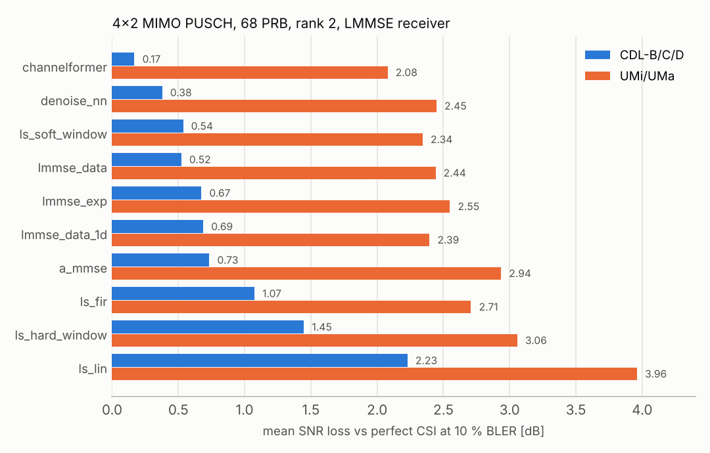

# WirelessNN: 5G NR uplink receiver and channel-estimation simulator

[](https://github.com/upv/WirelessNN/actions/workflows/tests.yml)

A link-level simulator for **5G NR PUSCH receivers, channel estimation and
interference rejection**, built on [NVIDIA Sionna](https://nvlabs.github.io/sionna/)
PHY 2 (PyTorch). It turns an algorithm choice into coded BER/BLER and into the
**working point**, the SNR needed to reach BER = 0.01 or BLER = 0.1, so classical and
learned estimators and receivers can be compared on the same slots.

- 5 channel models (CDL-B/C/D, 3GPP UMi/UMa), up to 4 co-scheduled UEs with rank 1–2,
  1, 2, 4 or 8 gNB antennas, other-cell interference.
- 6 receivers, from matched filter to interference rejection combining (IRC) with a
  measured covariance.
- 14 built-in channel estimators (LS, LMMSE, delay-domain windows, EqDeepRx, A-MMSE)
  and a plugin hook for your own, with [Channelformer](experiments/channelformer/README.md)
  as a worked example.
- Tools for large campaigns, datasets for learned estimators and working-point
  prediction, and a physics test suite.

## Results at a glance



In a 4x2 MIMO campaign (68 PRB, rank 2, 45 scenarios) the Channelformer estimator
loses 0.17 dB on average against perfect CSI on CDL channels, and the best classical
estimators lose about 0.5–0.7 dB. On UMi/UMa every estimator loses 2–4 dB, most of it
at 64QAM. Across 5000 random channel configurations the matched-prior LMMSE has the
lowest median loss (0.6 dB) but misses the target in 16 % of them. These and other
results, with setups and reproduction commands, are in [docs/RESULTS.md](docs/RESULTS.md).

## Quick start

Python 3.10 or newer. A CPU is enough for everything in this section; a GPU is
recommended for full 68-PRB campaigns.

```bash
git clone https://github.com/upv/WirelessNN.git
cd WirelessNN
scripts/setup_env.sh              # creates .venv, installs everything, runs an installation check
source .venv/bin/activate
python examples/01_quickstart.py  # first SNR sweep
```

`setup_env.sh` ends with `scripts/check_install.py`, which prints the library versions,
the device the simulator will use (GPU or CPU), whether the trained estimator models
are present, and runs a three-point smoke simulation (about 10 seconds on a CPU). On a GPU machine, if it reports
no GPU, install the PyTorch wheel that matches your CUDA driver into `.venv`
([selector](https://pytorch.org/get-started/locally/)) and run it again.

The quick-start example sweeps the SNR on a small 8-PRB allocation for the IRC
receiver with five channel estimators, at IoT 0 and 10 dB. It takes about 30 seconds
on a 4-core laptop CPU and prints one line per SNR point, then the working points:

```text
=== CDL-C | QAM16 | 1 UE x rank 1 | IoT=10.0 dB | CSI=perfect,ls_nn,ls_lin,ls_lin_time_avg,lmmse_ce ===
  SNR  -20.0 dB | perfect BER=4.813e-01 BLER=1.00e+00 | ls_nn BER=5.022e-01 BLER=1.00e+00 | ... | [1.2 s]
  ...
Working points (BER = 0.01)
  IoT = 0.0 dB
    perfect       5.08 dB
    ls_nn         5.16 dB
    ...
  IoT = 10.0 dB
    perfect       15.00 dB
    ...
```

The SNR grid is a coarse 5 dB here, so the working points are rough; refine
`SNR_DB` near the crossing for real comparisons. A JSON with every curve and the
BER/BLER and working-point figures land in `results/examples/`. Edit the knobs at the
top of the file (channel, modulation, UEs, receivers, estimators) and run it again.

The same kind of run from the command line:

```bash
python -m nr_ul_sim --list                       # every channel, receiver and estimator, with a description
python -m nr_ul_sim --quick --channel cdl-c --receivers lmmse,irc --estimators ls_lin,lmmse_exp
python -m nr_ul_sim --help                       # all options
```

`--quick` shrinks any command to an 8-PRB, few-second smoke run. Drop it and set
`--num-prb`, `--snr-db=-20:30:2`, `--batch-size` and `--max-mc-iter` for real runs.

## Next steps

| To | Read or run |
| --- | --- |
| understand one slot end to end | `python examples/02_one_slot_step_by_step.py` |
| compare receivers under interference | `python examples/03_receivers_vs_interference.py` |
| compare channel estimators (NMSE and working point) | `python examples/04_channel_estimators.py` |
| build a channel → working-point dataset | `python examples/05_working_point_dataset.py`, [docs/DATASET.md](docs/DATASET.md) |
| plug in your own channel estimator | [tutorial section 6](docs/TUTORIAL.md#6-channel-estimators), [experiments/channelformer](experiments/channelformer/README.md) |
| run full campaigns on a GPU | [tutorial sections 9–10](docs/TUTORIAL.md#9-random-channel-campaign) |
| check the physics | `python -m pytest tests`, `python scripts/physics_checks.py --outdir physics_out` |

## Documentation

| Document | Contents |
| --- | --- |
| [docs/TUTORIAL.md](docs/TUTORIAL.md) | guided tour: first run, configuration, receivers, estimators, results, datasets, campaigns, troubleshooting |
| [docs/MODEL.md](docs/MODEL.md) | what is simulated: scope, SNR and IoT definitions, receivers, estimators, known limitations |
| [docs/ARCHITECTURE.md](docs/ARCHITECTURE.md) | module map, data flow of one slot, tensor shapes, conventions |
| [docs/DATASET.md](docs/DATASET.md) | the channel → working-point dataset |
| [docs/RESULTS.md](docs/RESULTS.md) | campaign results |
| [CHANGELOG.md](CHANGELOG.md) | what changed and when |

## Repository layout

```text
nr_ul_sim/      the simulator package (python -m nr_ul_sim, python -m nr_ul_sim.dataset)
examples/       five numbered starter scripts, each runs on a CPU in minutes
scripts/        setup and installation check, physics report, campaigns, dataset tools, training
experiments/    self-contained studies: Channelformer 4x2 campaign, LS-denoising dataset
models/         trained estimator weights (paper_ce) and regression benchmarks
tests/          pytest suite (python -m pytest tests)
docs/           tutorial, model reference, architecture, dataset, results
dataset/        metadata of datasets built during development (tensors are not in Git)
```

## Python API

```python
from nr_ul_sim import NRUplinkSimulator, SimConfig

cfg = SimConfig(
    channel="umi",
    num_ue=2,
    num_layers=1,
    modulation="qam16",
    snr_db=list(range(-10, 31, 4)),
    iot_db=[0, 10],
    receivers=("lmmse", "irc"),
    channel_estimators=("ls_lin",),
    num_prb=8,
)
campaign = NRUplinkSimulator(cfg).run()
print(campaign["iot"]["10.0"]["irc"]["working_point_db"])
```

Every `SimConfig` field is documented in `nr_ul_sim/parameters.py`, and the
command-line options map onto them one to one.

## Scope

This is a frequency-domain simulator with ideal synchronisation, not a complete
hardware receiver. `irc` uses the perfect interference covariance by default; use
`irc_real` or `--iot-cov residual` for a measured one. Learned estimators in
`models/paper_ce` were trained on UMa only. See
[docs/MODEL.md](docs/MODEL.md#known-limitations) for the full list.

## Author

[Pavel Uydanov](https://github.com/upv) ·
[LinkedIn: project and R&D enquiries](https://www.linkedin.com/in/pavel-uydanov/)

Related work: [SVD Lab](https://github.com/upv/Pavel-s_SVD), a numerical algorithm and
GPU benchmarking laboratory.
