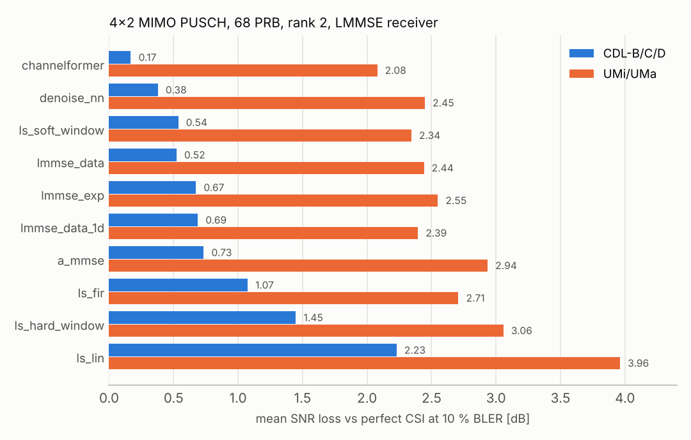

# Results

Selected results produced with the code in this repository. Each section names the
setup and where the full tables and the scripts to reproduce them live. All numbers
are specific to their setup and code revision. In particular, the soft-window results
from before 2026-10-06 need `--ce-soft-noise-mode thermal` to reproduce.

**Working point:** the SNR (per receive antenna and resource element) where coded BER
reaches 0.01 or BLER reaches 0.1. **CE loss:** working point of an estimator minus
the working point with perfect CSI on the same slots.

Contents:
[1 Neural estimators over the air](#1-neural-estimators-over-the-air) ·
[2 4x2 MIMO: 14 estimators and Channelformer](#2-4x2-mimo-14-estimators-and-channelformer) ·
[3 Trained estimators at 68 PRB](#3-trained-estimators-at-68-prb) ·
[4 Random-channel campaign](#4-random-channel-campaign-5000-configurations) ·
[5 Interference-aware soft window](#5-interference-aware-soft-window) ·
[6 Linear baselines for LS denoising](#6-linear-baselines-for-ls-denoising) ·
[7 Physical validation](#7-physical-validation)

## 1. Neural estimators over the air

**November 2026.** Five recent neural channel estimators
([ce_zoo](../experiments/ce_zoo/README.md): CHEA, CHEA-XL, HELENA, SwiftChannel and the
EqDeepRx DenoiseNN), Channelformer and the classical estimators, first in simulation and
then replayed on uplink captures from an OAI-based 5G stand with two commercial UEs and a
2-antenna gNB (1 layer, mostly 24 PRB, uplink SNR 16 to 21 dB, six UE sets of about
2 700 decoded slots each). There is no true channel on air, so each slot is scored by its
fit SNR |cHX|^2 / |Y - cHX|^2 on the data REs, with X rebuilt from the decoded transport
block; the two antennas are combined by maximum-ratio combining.

| Estimator | Weights | Simulation NMSE, 4x2 [dB] | Simulation NMSE, stand layout [dB] | Over the air, gain vs gNB estimate [dB] |
| --- | ---: | ---: | ---: | ---: |
| `zoo_chea_xl` | 302k | -16.29 | -17.70 | +0.88 to +0.97 |
| `zoo_denoiserx` | 42k | **-16.60** | -17.56 | +0.87 to +0.97 |
| `channelformer`\* | 192k | -15.33 | | +0.82 to +0.93 |
| `zoo_helena` | 133k | -15.16 | -16.54 | +0.76 to +0.85 |
| `zoo_swift` | 9.6k | -14.56 | -15.62 | +0.71 to +0.78 |
| `zoo_chea` | 33k | -15.24 | -15.55 | +0.66 to +0.73 |
| `lmmse_exp`\* | 0 | -13.07 | -13.78† | +0.58 to +0.78 |
| soft delay window\* | 0 | -12.25 | -12.79 | +0.35 to +0.76 |
| hard delay window\* | 0 | -6.39 | -8.13 | +0.09 to +0.33 |
| LS + linear interpolation | 0 | -4.52 | -6.28 | -0.07 to +0.07 |

Over the air: range of the median per-slot gain over the six UE sets. Stand-layout NMSE:
24 PRB, PUSCH mapping type B, 13 symbols, DMRS at 0/5/10, random timing offsets of up to
±400 ns. \* With the stand's mean delay (about -110 ns, an early FFT window) removed
before estimation; without it the delay windows lose 0.4 to 1.9 dB to the gNB estimate.
LMMSE in simulation: exponential prior with 300 ns delay spread, noise level estimated from
the slice, no delay removal (on air: 100 ns, delay removed). † Without timing offsets; with
them it drops to -5.75 dB, because its causal prior cannot follow negative delays.

- **Small is enough.** DenoiseNN with 42k weights matches CHEA-XL with 300k, in
  simulation and on air; even the 9.6k-weight SwiftChannel is level with LMMSE or better.
- **Train for the timing offset.** Models trained with random offsets handle the stand's
  delay themselves: removing it first changes their result by at most 0.03 dB.
- **Two antennas roughly double the gain.** With one receive antenna the same models
  gain +0.17 to +0.38 dB (CHEA-XL +0.38, LMMSE +0.21), since noise dominates at this SNR.
- **Link level (simulation).** A quick BLER sweep on the 4x2 link (5 channels x 3 MCS,
  30 km/h) gives a mean loss against perfect CSI of 0.65 dB (DenoiseNN, CHEA-XL) to
  0.79 dB (SwiftChannel), Channelformer 0.73 dB, the simulator's `lmmse_exp` 1.57 dB;
  differences below about 0.3 dB are within the sweep's accuracy
  ([table](../experiments/ce_zoo/README.md#results-bler-working-points)).
- The air interface was rank 1 at one SNR range in one room.

Recipes, per-model deviations from the papers and the full tables:
[experiments/ce_zoo](../experiments/ce_zoo/README.md). The capture and replay tools are
not part of this repository.

## 2. 4x2 MIMO: 14 estimators and Channelformer

**November 2026.** One UE with 2 antenna ports at rank 2, 4 gNB antennas (one
38.901 panel 1x2 dual-pol), 68 PRB, 30 kHz, LMMSE receiver with LDPC decoding, no
interference. 45 scenarios: CDL-B/C/D, UMi, UMa × 3 / 30 / 120 km/h × QPSK, 16QAM,
64QAM. All 14 built-in estimators and
[Channelformer](../experiments/channelformer/README.md) (Luan & Thompson, IEEE TWC
2023), plugged in with `--ce-plugin`.

| Estimator | Mean CE loss, all [dB] | CDL-B/C/D | UMi/UMa | Scenarios without 10 % BLER |
| --- | ---: | ---: | ---: | ---: |
| `channelformer` | **0.91** | **0.17** | **2.08** | 1 |
| `denoise_nn`\* | 1.18 | 0.38 | 2.45 | 1 |
| `ls_soft_window` | 1.23 | 0.54 | 2.34 | 1 |
| `lmmse_data`\* | 1.29 | 0.52 | 2.44 | 0 |
| `lmmse_data_1d`\* | 1.35 | 0.69 | 2.39 | 1 |
| `lmmse_exp` | 1.43 | 0.67 | 2.55 | 0 |
| `a_mmse`\* | 1.58 | 0.73 | 2.94 | 1 |
| `ls_fir` | 1.70 | 1.07 | 2.71 | 1 |
| `ls_hard_window` | 2.07 | 1.45 | 3.06 | 1 |
| `ra_a_mmse`\* | 2.75 | 1.69 | 4.99 | 5 |
| `ls_lin` | 2.85 | 2.23 | 3.96 | 3 |
| `ls_nn` | 3.40 | 2.76 | 4.70 | 9 |
| `ls_lin_time_avg` | 2.11 | 1.56 | 3.07 | 12 |
| `lmmse_ce` | 0.56 | 0.56 | fails | 18 |

Means are over the scenarios where the estimator reached 10 % BLER, so estimators that
fail more often look better than they are. \* trained on UMa only (`models/paper_ce`).

- **Channelformer is the best realisable estimator overall** and stays within 0.5 dB
  of perfect CSI on every CDL scenario. It was trained on a mix of all five channel
  families, the paper estimators on UMa only, so part of its lead is training data.
- **UMi/UMa at 64QAM is hard for every estimator:** 3–6 dB loss, and several
  estimators never reach 10 % BLER at 120 km/h.
- `lmmse_ce` uses a TDL prior equal to the CDL power-delay profile, i.e. a genie on
  CDL, and fails on UMi/UMa. `ra_a_mmse` (rank 6) breaks down at 120 km/h.
- Each BLER point has at most 200 blocks, so differences below about 0.3 dB are within
  Monte-Carlo noise.

Full per-scenario tables, NMSE versus SNR and BLER curves:
[report.md](../experiments/channelformer/results/mimo4x2_20261116/report.md).
Commands to reproduce: [experiments/channelformer](../experiments/channelformer/README.md).

## 3. Trained estimators at 68 PRB

**October 2026.** IRC receiver, 68 PRB, 4 gNB antennas. 36 link-level campaigns
over CDL-B, CDL-C, UMi, UMa × QPSK / 16QAM / 64QAM × (1 UE rank 1, 2 UEs rank 1,
2 UEs rank 2), each at IoT 0 and 10 dB (72 cases), plus 12 campaigns comparing the
IRC interference-covariance estimators. The
estimators of EqDeepRx (arXiv:2602.11834) and A-MMSE (arXiv:2506.00452) were trained
on UMa (`scripts/training/train_paper_ce.py`); UMi and CDL are outside their training
distribution.

| Estimator | Median CE loss, BER = 1e-2 [dB] |
| --- | ---: |
| `denoise_nn` (EqDeepRx DenoiseNN) | **0.63** |
| `lmmse_exp` (LMMSE, exponential prior) | 0.64 |
| `lmmse_data` (LMMSE, data covariance) | 0.99 |
| `a_mmse` | 1.05 |
| `ra_a_mmse` (rank 6) | 1.07 |
| `ls_soft_window` | 1.16 |
| `ls_fir` | 1.31 |
| `ls_lin` | 2.84 |

- DenoiseNN carries over to CDL outside its training set (CDL-B 0.18 dB, CDL-C
  0.34 dB; `lmmse_exp` 0.15 / 0.57 dB) but misses the working point in 9 of 72 cases.
- A-MMSE converges to the best fixed linear filter, as its paper says, and does not
  beat `lmmse_data`, its closed-form limit.
- RA-A-MMSE with rank 6 loses 2–4.5 dB NMSE above 10 dB SNR on UMa validation.

Reproduce: `scripts/campaigns/run_paper_ce_campaign.sh`, then
`scripts/campaigns/report_paper_ce.py` (NMSE curves:
`scripts/training/eval_paper_ce.py`).

## 4. Random-channel campaign (5000 configurations)

**October 2026.** 5000 random configurations at 16 PRB (1000 per channel family),
IRC with perfect interference covariance, all 14 estimators on shared slots. Every
configuration draws its own delay spread (20–1000 ns), cluster angles, K-factor,
UE geometry, speed (0.5–120 km/h), IoT and interferers
(`nr_ul_sim/random_channels.py`); the working point is found by an adaptive,
censoring-aware search (`nr_ul_sim/wp_search.py`). 9 h 16 min on one RTX PRO 6000
with 3 workers.

| Estimator | Working point found | Median CE loss, found only | Median with censoring | p90 with censoring |
| --- | ---: | ---: | ---: | ---: |
| `lmmse_ce` (TDL prior) | 84 % | 0.63 dB | 0.83 dB | not found |
| `denoise_nn` | 90 % | 0.68 | 0.77 | not found |
| `lmmse_exp` | 92 % | 1.02 | 1.13 | 4.26 |
| `a_mmse` | 93 % | 1.19 | 1.29 | 5.98 |
| `lmmse_data` | 96 % | 1.32 | 1.37 | 3.95 |
| `ra_a_mmse` | 86 % | 1.33 | 1.56 | not found |
| `ls_lin` | 93 % | 2.59 | 2.75 | 5.57 |

"With censoring" counts a working point that was not found as infinite loss.

- Ranked by median loss and ranked by reliability give different orders: the
  matched-prior LMMSE is best when it works but misses 16 % of configurations.
- A-MMSE matches `lmmse_data` within ±0.25 dB in half of the configurations, but has
  a heavier tail (no working point in 7.1 % vs 3.9 %, median loss 15.4 dB above
  1000 ns delay spread): a filter bank learned on UMa needs a delay-spread dimension.
- Labels are reproducible: every working point is recomputed exactly from the stored
  BER curves, and a dense re-simulation of 16 configurations agrees within ±0.3 dB.

Reproduce: [tutorial section 9](TUTORIAL.md#9-random-channel-campaign).

## 5. Interference-aware soft window

**October 2026.** `ls_soft_window` now estimates the per-tap disturbance floor from
the taps outside the delay window instead of from thermal noise alone. Soft-window
NMSE at 68 PRB, CDL-C, 1 UE, old (`thermal`) → new (`outside`, default):

| Condition | SNR 5 dB | SNR 15 dB | SNR 25 dB |
| --- | --- | --- | --- |
| IoT 10 dB | −2.7 → **−10.3** | −12.4 → **−17.2** | |
| IoT 20 dB | | −2.0 → **−10.8** | |
| no interference | | **−22.7** → −21.7 | **−27.2** → −24.1 |

With interference the new floor gains 5–12 dB. Without it, it costs up to 3 dB at
high SNR, because band-limited leakage of the channel taps raises the out-of-window
median above the thermal floor. The same estimator feeds the measured-covariance IRC
receiver `irc_real`; compare it with genie IRC using
`scripts/campaigns/benchmark_irc_real.py`.

## 6. Linear baselines for LS denoising

**October 2026.** A 20 250-realisation dataset of LS estimate → true channel pairs
(16 PRB, 4 RX, CDL/UMi/UMa, SNR −20…10 dB, IoT 0/10/20 dB) for training denoising
estimators. On 4050 test channels: LS with linear interpolation +20.3 dB NMSE, one
shared ridge map on LS −1.1 dB, LMMSE with known interference-plus-noise power
**−4.4 dB**. Details, breakdowns and the bit-level (BCE) metric:
[experiments/ce_denoising/REPORT.md](../experiments/ce_denoising/REPORT.md).

## 7. Physical validation

- `tests/test_physics.py` and `scripts/physics_checks.py` check every block on its
  own: TB size against 38.214, DMRS layout and power, channel energy, delay spread,
  Jakes time correlation, frequency and spatial correlation, SNR and INR calibration,
  covariance estimators, receiver identities (IRC ≡ L-MMSE without interference).
- In the random-channel campaign the perfect-CSI working point follows the theoretical
  post-IRC SINR (correlation 0.93–0.97); the gap to Shannon is 1.2 / 2.6 / 3.4 dB for
  QPSK / 16QAM / 64QAM, as expected for BICM with max-log demapping and short LDPC
  blocks.
