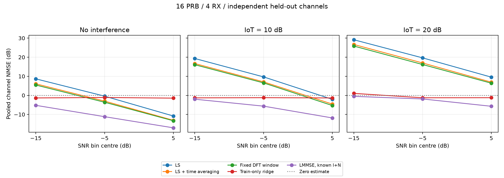
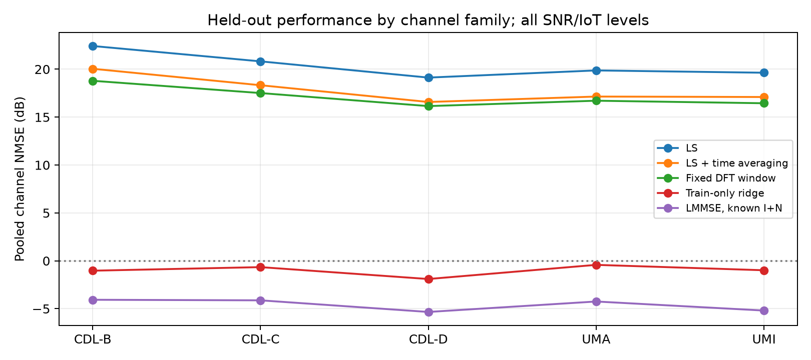

# Пробный датасет для оценки канала на 16 PRB

**14 октября 2026.** Создано 900 независимых реализаций для обучения модели
**LS channel estimation → чистый истинный канал**. На 180 test-реализациях
линейный LMMSE с ковариацией, обученной на train, и известной мощностью I+N
достиг **MSE 0,349 / NMSE −4,56 dB**. Одна общая линейная регрессия только по LS
дала **MSE 0,797 / NMSE −0,97 dB**. Это измеренные ориентиры для будущей модели,
а не оценка предела достижимого качества нейросети.

Генератор, PyTorch-загрузчик, MSE/BCE losses, анализ и инструкция находятся
в этой папке. Данные сохранены на **yadro / parfen**:
`/home/debian/WirelessNN/experiments/ce_denoising/data/pilot_16prb`.
Схема массивов и команды — в [README.md](README.md).

## Состав и проверка датасета

| Параметр | Пробный набор |
| --- | --- |
| Разделение | 540 train / 180 validation / 180 test, независимые seeds и каналы |
| Радиосетка | 16 PRB, 192 поднесущие, FFT 256, 14 символов, 30 кГц, 3.5 ГГц |
| Целевой UE | 1 UE, rank 1, 1 TX, 4 RX |
| Вход и цель | Комплексные `h_ls` и `h_true`, каждый `[4,14,192]` |
| Компактный LS | `[4,2,48]`: два DMRS-символа, 48 CDM-блоков |
| Семейства каналов | CDL-B/C/D, UMa, UMi; по 180 записей |
| SNR | Случайный −20…10 dB; фактически −19,978…9,994 dB |
| IoT | 0 / 10 / 20, по 300 записей; 0 = отсутствие интерференции |
| Интерфереры | Случайно 2…6; при IoT=0 их каналы сохранены, принятые вклады равны нулю |
| Скорость | Независимо 3…30 км/ч для цели и каждого интерферера |
| Модуляция | 299 QPSK / 307 16QAM / 294 64QAM |
| Объём | 1 260 711 114 байт, примерно 1,26 GB / 1,17 GiB |
| Время | Около 318,5 с целиком; 266,5 с непосредственно генерации/проверок примеров |
| Окружение | RTX PRO 6000 Blackwell, PyTorch 2.14, Sionna 2.1, NumPy 2.5.3 |

Генератор варьирует cluster delays/angles/spreads и K-factor CDL-D, а для
UMa/UMi сохраняет случайную топологию, LoS/indoor, LSP и параметры лучей.
У цели фактические скорости 3,004…29,994 км/ч; у 3621 настроенной связи
интерфереров — 3,003…29,992 км/ч. Масштаб DS у CDL покрывает примерно 20…985 ns.
LSP DS у UMa — 15…2455 ns, у UMi — 3,8…1595 ns: это модельные распределения,
а не обрезка до CDL-диапазона. Параметры и исходные CIR хранятся вместе с каждым
примером; они позволяют восстановить истинный H с исходной нормировкой.

Средняя измеренная мощность шума составила **0,99948 от заданной**. Среднее
отклонение измеренного SNR от номинального — **−0,019 dB**, INR — **−0,025 dB**.
Номинальный SNR задан для канала, нормированного по полной FFT-сетке, поэтому
реализованный SNR на активных поднесущих не обязан совпадать с ним в каждом
слоте. Полные агрегаты: [sampling.csv](reports/sampling.csv),
[coverage.csv](reports/coverage.csv).

Для каждой записи проверены конечность чисел, допустимые диапазоны и тождества
`y = H*x + noise + interference`, сумма отдельных интерфереров и разложение LS.
Перед анализом проверены SHA-256 обоих NPZ каждого примера. Тесты проверяют
воспроизводимость, восстановление H из CIR, соответствие DFT-фильтра основному
симулятору, градиент BCE, resume и обнаружение повреждённого файла. **20 тестов
нового эксперимента и общего модуля random channels прошли на сервере**;
последующая проверка CIR для всех пяти семейств также прошла.

## MSE и линейные методы

Complex MSE — среднее `|Hhat−H|²` по RE, антеннам и независимым test-примерам.
NMSE — отношение суммарной ошибки к суммарной энергии истинного канала, затем
`10 log10`. Средняя энергия истинного канала на test составляет **0,9959**.
Интервалы 95% — percentile bootstrap из 2000 повторов по целым реализациям;
антенны и RE одного канала не считаются независимыми наблюдениями.

| Метод | MSE | 95% интервал MSE | NMSE, dB |
| --- | ---: | ---: | ---: |
| Нулевая оценка | 0,996 | 0,985…1,006 | 0,00 |
| LS и линейная интерполяция | 112,654 | 72,132…159,711 | 20,54 |
| LS и усреднение по DMRS во времени | 63,202 | 40,059…90,374 | 18,03 |
| Фиксированное DFT-окно −1…+3 мкс | 52,605 | 33,685…74,134 | 17,23 |
| Одна ridge map, только LS | 0,797 | 0,751…0,856 | −0,97 |
| LMMSE с известной мощностью I+N | **0,349** | **0,301…0,399** | **−4,56** |
| LS без шума и интерференции | 0,00243 | 0,00181…0,00314 | −26,13 |

Noiseless LS — диагностическая ошибка CDM-усреднения и интерполяции, а не
достижимый результат на зашумлённом входе. Истинный H даёт нулевой MSE по
определению; условные −300 dB в машинных CSV для него — технический floor
логарифма, не физическая ошибка.

Ridge обучает одну affine linear map из 96 комплексных LS-пилотов на 2688 RE
для каждого RX-порта. Она использует только доступный LS-вход: компактные
пилоты извлекаются из полного `h_ls` на соответствующих DMRS/поднесущих.
Сильная общая регуляризация полезна в тяжёлых условиях, но излишне подавляет
канал при хорошем SNR. Validation выбрал λ=`trace(C_obs)/96`.

LMMSE использует train-only ковариацию чистых LS-пилотов и cross-covariance с
истинным каналом. Для каждой записи добавляется диагональный шум
`(N0+I0)/4`: деление на четыре учитывает энергию DMRS и усреднение двух пилотов.
Validation выбрал множитель этой мощности **1,0**. Этот метод получает известные
SNR/IoT; сравнивать его с сетью, которой доступен только LS, надо с учётом этой
дополнительной информации. Пространственные cross-covariance четырёх антенн
в текущем фильтре не используются.

Средний выигрыш LMMSE относительно LS — **25,09 dB по MSE**, но большая часть
числа отражает подавление огромной ошибки LS при очень сильной интерференции.
Сравнение с нулевой оценкой содержательнее: выигрыш LMMSE **4,56 dB**, общей
ridge map **0,97 dB**. Эти цифры зависят от выбранной равномерной смеси SNR/IoT.

Раздельные записи помехи подтверждают причину большого LS MSE: при IoT=20
средняя мощность ошибки от интерференции составляет **301,11**, от теплового
шума **3,04**, от интерполяции **0,00175**. С учётом перекрёстных членов их
сумма даёт MSE **303,74** в этой группе. Перекрёстные члены конечной выборки
сохранены отдельно; складывать только три мощности как точное равенство нельзя.

## Зависимость от SNR и IoT

Каждая ячейка ниже содержит 20 независимых test-каналов. SNR внутри интервала
случайный; это агрегаты по интервалам, не измерения ровно в их центрах.

| IoT | SNR, dB | LS NMSE | DFT NMSE | Ridge NMSE | LMMSE NMSE |
| --- | --- | ---: | ---: | ---: | ---: |
| 0 | −20…−10 | 8,65 | 5,42 | −1,36 | −5,24 |
| 0 | −10…0 | −0,42 | −3,61 | −1,13 | −11,18 |
| 0 | 0…10 | −10,84 | −13,32 | −1,46 | −17,03 |
| 10 | −20…−10 | 19,32 | 16,07 | −1,32 | −2,02 |
| 10 | −10…0 | 9,68 | 6,53 | −1,22 | −5,66 |
| 10 | 0…10 | −2,09 | −5,34 | −1,36 | −11,84 |
| 20 | −20…−10 | 29,15 | 25,85 | 1,03 | −0,53 |
| 20 | −10…0 | 19,65 | 16,16 | −1,28 | −1,89 |
| 20 | 0…10 | 9,55 | 6,38 | −1,23 | −5,73 |

Средний NMSE LMMSE по IoT: **−8,77 / −4,94 / −2,24 dB** для 0/10/20.
При IoT=20 и SNR от −20 до −10 даже этот фильтр лишь немного превосходит
нулевую оценку. Сильное регуляризующее подавление здесь не означает, что
удалось подробно восстановить канал.

По семействам средний NMSE LMMSE: CDL-B **−4,07**, CDL-C **−4,12**, CDL-D
**−5,34**, UMa **−4,25**, UMi **−5,19 dB**. На семейство приходится только
36 test-примеров; устойчивое ранжирование семейств требует большей выборки.

Машинные агрегаты: [общие](reports/aggregate.csv), [SNR и IoT](reports/by_snr_iot.csv),
[каналы](reports/by_channel.csv), [IoT](reports/by_iot.csv),
[состав ошибки LS](reports/error_components.csv).

## BCE и выбор функции потерь

Для BCE сохранены `x_tx`, data mask, QAM-символы и их coded bit labels,
исходный transport block, принятый сигнал и отдельные составляющие помехи.
`symbol_bce` реализует дифференцируемую цепочку Hhat → SIMO combining → QAM
logits → BCE. Производная по Hhat проверена для всех пяти семейств каналов.
BCE применяется к переданным битам после QAM mapping, не непосредственно к
коэффициентам канала и не к исходным TB-битам перед LDPC.

| Оценка канала | Средний BCE, nat/bit |
| --- | ---: |
| Нулевая | 0,69315 |
| LS | 0,75212 |
| LS с усреднением | 0,68755 |
| Фиксированное DFT-окно | 0,66847 |
| Ridge | 0,63829 |
| LMMSE с известной I+N | 0,57457 |
| Истинный H | 0,56834 |

Здесь сначала усредняются биты одного примера, затем примеры. Likelihood
использует одинаковую для методов известную мощность N0+I0 и приближение белой
Gaussian помехи. Окрашенная covariance и неопределённость Hhat не входят в
likelihood. Это surrogate для обучения; таблица не измеряет coded BER/BLER и
не доказывает близость к пределу декодирования. При IoT=20 даже истинный H даёт
BCE 0,68344 — близко к случайному угадыванию 0,69315 в таком приёмнике.

Для первой нейросети разумно начать с complex MSE и проверять её против ridge
и условного LMMSE на одинаковом входе. Затем добавить BCE и оценивать компромисс
между MSE и битовой метрикой на validation. Низкий MSE и хорошая калибровка
битовых вероятностей — разные свойства; коэффициент смешанного loss нельзя
выбирать по этому test-набору. Нейросеть в данном эксперименте не обучалась.

## Следующий масштаб эксперимента

Текущие 540 обучающих каналов достаточны для проверки тракта и начальных
линейных фильтров, но малы для оценки обобщения нейросети. Имеет смысл увеличить
train, оставить независимые геометрии в validation/test и сравнить варианты:
LS-only, LS с оценённой мощностью помехи и LS с известной мощностью как reference.
Проверку BER/BLER следует проводить с одной и той же моделью детектора.

Полезное расширение — фильтр или сеть, использующие совместно четыре RX-порта,
а также соседние PUSCH с DMRS, если нужна устойчивость к pilot contamination.
Текущий датасет использует Gaussian OFDM-интерфереры и идеальную частотную
модель без ISI/ICI; его результаты относятся именно к этим условиям.

Грубая линейная проекция пилота: **10 тысяч примеров ≈14 GB и около 59 минут**,
100 тысяч ≈140 GB и около 9,8 часа на этом сервере. Это оценка по 900 примерам,
без запуска большого набора и без учёта изменения скорости диска/нагрузки.

В Git включены код, тесты, документация и агрегированные результаты. Каналы,
параметры отдельных реализаций, обученные фильтры и рабочие логи остаются в
игнорируемых `data/`, `artifacts/`, `runs/`.
