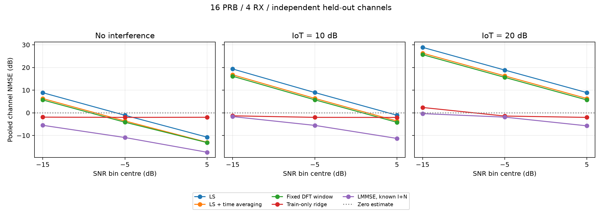
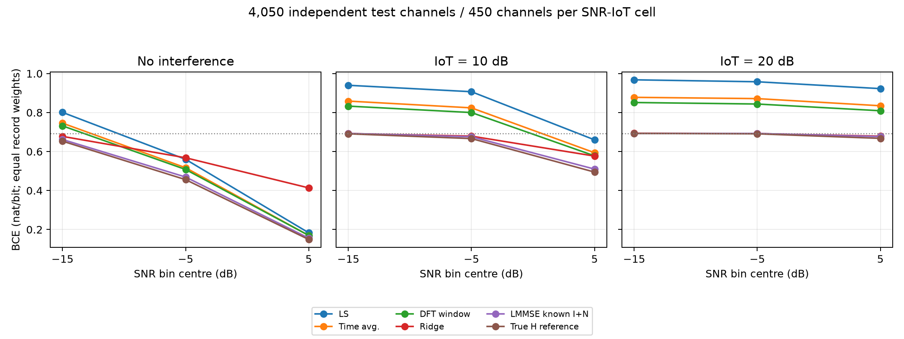
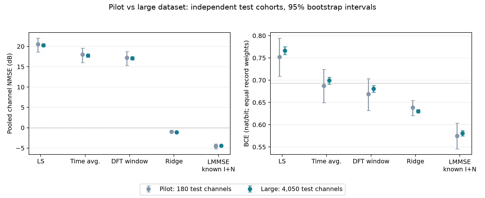

# Linear channel-estimation baselines on the 16-PRB denoising dataset

**October 2026.** Reference numbers that a trained LS-denoising model has to beat,
measured on the dataset described in [README.md](README.md). On **4050
independent test channels**:

| Method | MSE | NMSE | BCE, nat/bit |
| --- | ---: | ---: | ---: |
| LS, linear interpolation | 106.46 | +20.30 dB | 0.7666 |
| One shared ridge map on LS only | 0.769 | −1.11 dB | 0.6302 |
| LMMSE with known I + N power | **0.358** | **−4.43 dB** | **0.5808** |

LMMSE is the best method tested on average over this mix of conditions, but it uses
the known interference-plus-noise power. Growing the training set from 540 to
12 150 channels changed the LMMSE filter very little (−0.2 % MSE on the same test
channels) and the ridge map by −4.8 %. These are baselines for this filter
structure, not limits for other linear methods or neural networks.

## Data and protocol

| | Pilot set | Main set |
| --- | ---: | ---: |
| Realisations | 900 | 20 250 |
| Train / validation / test | 540 / 180 / 180 | 12 150 / 4050 / 4050 |
| Test channels per channel family | 36 | 810 |
| Test channels per (SNR band, IoT) cell | 20 | 450 |
| Size on disk | 1.26 GB | 28.2 GB |
| Generation time (RTX PRO 6000 Blackwell) | 5 min 19 s | 1 h 58 min |

Both sets use the same grid and distributions: 16 PRB, 192 subcarriers, FFT 256,
14 symbols, one target UE, rank 1, 4 RX. CDL-B/C/D, UMa and UMi have equal shares;
SNR is uniform in −20…10 dB; IoT is 0 / 10 / 20 dB with equal probability
(**IoT = 0 means no interference**); 2…6 potential interferers; target and
interferer speeds independently 3…30 km/h. All seeds are unique and the two sets do
not overlap. Ranges and distributions are checked in
[sampling.csv](evaluation_20k/reports/sampling.csv) and
[coverage.csv](evaluation_20k/reports/coverage.csv).

Sanity checks: measured noise power is 0.9995 of the nominal value, measured SNR
and INR deviate from nominal by −0.02 dB on average. Every record passed the
finiteness, range and identity checks (`y = H·x + noise + interference`, sum over
interferers, LS decomposition) and the SHA-256 of both NPZ files was verified before
analysis.

Coefficients are fitted on train only, regularisation is chosen by validation MSE,
and test is used only for the numbers below. No method is optimised for BCE.

- **LS:** Sionna CDM despreading of the DMRS and linear interpolation.
- **LS, time average:** the two DMRS estimates averaged over time.
- **DFT window:** fixed delay window −1…+3 µs, then interpolation.
- **Ridge:** one affine map from the 96 complex LS pilot values to the 2688 REs,
  shared by all RX ports. The input is only the LS estimate. Validation chose
  `λ = 0.1·trace(C_obs)/96` (1.0 on the pilot set).
- **LMMSE:** train-set covariance of the clean pilots and cross-covariance with the
  true H, diagonal loading `(N0 + I0)/4` for the current record (the factor 4
  accounts for DMRS energy and averaging two pilots). Validation kept the power
  factor at 1.0. Spatial covariance across the four RX ports is not used.

## Results on the test set

MSE is mean |Ĥ − H|² over REs, antennas and records. NMSE is total error over total
channel energy (mean |H|² = 0.994 here). BCE is computed on the coded QAM bits after
Ĥ → SIMO combining → QAM logits, averaged over the bits of a record and then over
records; every method gets the same known N0 + I0 for it. 95 % intervals are
percentile bootstrap over **whole realisations** (2000 resamples).

| Method | MSE | 95 % CI | NMSE, dB | BCE | 95 % CI |
| --- | ---: | --- | ---: | ---: | --- |
| Zero estimate | 0.99391 | 0.99163…0.99632 | 0.00 | 0.69315 | — |
| LS | 106.45856 | 97.57…115.88 | 20.30 | 0.76658 | 0.75743…0.77524 |
| LS, time average | 59.07477 | 54.16…64.39 | 17.74 | 0.69920 | 0.69140…0.70672 |
| DFT window | 50.76992 | 46.57…55.19 | 17.08 | 0.68051 | 0.67318…0.68772 |
| Ridge on LS | 0.76906 | 0.7524…0.7866 | −1.11 | 0.63022 | 0.62617…0.63398 |
| LMMSE, known I + N | **0.35841** | **0.3481…0.3695** | **−4.43** | **0.58084** | **0.57496…0.58672** |
| Noiseless LS (interpolation floor) | 0.004771 | 0.00414…0.00544 | −23.19 | 0.57420 | 0.56829…0.58019 |
| True H (reference) | 0 | 0 | −∞ | 0.57346 | 0.56752…0.57946 |

LMMSE beats LS by 24.7 dB in MSE, but that number mostly reflects the huge LS error
under strong interference: at IoT = 20 dB the LS MSE of 285.3 splits into 282.5 from
interference, 2.8 from noise and 0.004 from interpolation (plus cross terms; see
[error_components.csv](evaluation_20k/reports/error_components.csv)). Against the
zero estimate, LMMSE gains 4.43 dB.

### Where methods work and where they fail

Each row aggregates 450 test channels; SNR is random inside the band.

| IoT | SNR, dB | LS NMSE | DFT NMSE | Ridge NMSE | LMMSE NMSE | LMMSE BCE |
| --- | --- | ---: | ---: | ---: | ---: | ---: |
| 0 | −20…−10 | 8.86 | 5.67 | −1.91 | −5.52 | 0.6617 |
| 0 | −10…0 | −1.09 | −4.16 | −2.02 | −10.90 | 0.4692 |
| 0 | 0…10 | −10.73 | −13.13 | −1.97 | −17.40 | 0.1558 |
| 10 | −20…−10 | 19.33 | 16.12 | −1.33 | −1.67 | 0.6927 |
| 10 | −10…0 | 8.94 | 5.73 | −2.01 | −5.55 | 0.6759 |
| 10 | 0…10 | −1.08 | −4.20 | −2.05 | −11.30 | 0.5099 |
| 20 | −20…−10 | 28.88 | 25.67 | 2.35 | −0.36 | 0.6931 |
| 20 | −10…0 | 18.86 | 15.64 | −1.43 | −1.91 | 0.6927 |
| 20 | 0…10 | 8.91 | 5.67 | −2.03 | −5.75 | 0.6767 |

- At **IoT = 0, SNR 0…10 dB** the shared ridge map over-smooths: MSE 0.629 against
  0.084 for LS and 0.048 for the DFT window. Without interference the DFT window also
  has the better BCE (0.470 vs 0.553). Comparing a model only with the average ridge
  MSE is therefore not enough.
- At **IoT = 20, SNR −20…−10 dB** ridge is worse than the zero estimate (+2.35 dB)
  and LMMSE gains only 0.36 dB; its BCE is essentially ln 2. Even the true H gives
  0.6928 with this receiver.





By channel family (810 test channels each):

| Family | Ridge NMSE, dB | LMMSE NMSE, dB | LMMSE BCE |
| --- | ---: | ---: | ---: |
| CDL-B | −1.07 | −4.38 | 0.5879 |
| CDL-C | −0.97 | −4.49 | 0.5773 |
| CDL-D | −1.98 | −5.28 | 0.5899 |
| UMa | −0.66 | −3.77 | 0.5810 |
| UMi | −0.98 | −4.36 | 0.5681 |

More breakdowns: [by family](evaluation_20k/reports/by_channel.csv),
[by IoT](evaluation_20k/reports/by_iot.csv),
[by SNR and IoT](evaluation_20k/reports/by_snr_iot.csv),
[by modulation](evaluation_20k/reports/by_modulation.csv).

## Effect of the training-set size

Filters fitted on the pilot set (540 train channels, regularisation chosen on its
validation set) were frozen and applied to the same 4050 main-set test channels,
noise, interference and symbols as the filters fitted on 12 150 channels. Paired
differences "new − old" with 95 % intervals over realisations:

| Method | MSE old | MSE new | ΔMSE (95 % CI) | ΔBCE (95 % CI) |
| --- | ---: | ---: | --- | --- |
| Ridge | 0.80788 | 0.76906 | −0.0388 (−0.0462…−0.0313), −4.8 % | −0.0123 (−0.0134…−0.0113) |
| LMMSE | 0.35919 | 0.35841 | −0.00078 (−0.00101…−0.00056), −0.2 % | −0.00011 (−0.00018…−0.00007) |

540 training channels already give an LMMSE filter close to the one fitted on
12 150. Ridge gains more, but its selected regularisation changed at the same time,
so this compares two complete train/validation procedures, not the training-set size
alone. On the pilot set's own 180 test channels the numbers were MSE 0.349 /
NMSE −4.56 dB for LMMSE and 0.797 / −0.97 dB for ridge; the wider intervals there
(LMMSE MSE 0.301…0.399) are why the main set was generated.



Aggregates: [cohort_comparison.csv](evaluation_20k/reports/cohort_comparison.csv),
[same_test_training_size.csv](evaluation_20k/reports/same_test_training_size.csv).
The pilot-set aggregates and figures are kept in [reports/](reports/).

## What this means for a trained model

- An **LS-only** model should beat **MSE 0.769 / BCE 0.630** on average, and has to
  be checked separately at high SNR without interference (where the DFT window is
  strong) and at low SNR with IoT = 20 dB.
- A model that receives the I + N power should be compared with **MSE 0.358 /
  BCE 0.581**.
- Track MSE and BCE together. The BCE here is a surrogate after SIMO combining with
  a white Gaussian I + N model and no uncertainty of Ĥ; the real interference is
  spatially coloured. It is not coded BER/BLER, and the true-H value is not a lower
  bound for other detectors or interference-rejection schemes.
- The data model has Gaussian OFDM interferers, an ideal frequency-domain channel
  without ISI/ICI and no pilot contamination from neighbouring PUSCH. Joint
  processing of the four RX ports was not tested by these filters.

## Reproduce

From the repository root, with both datasets generated (see [README.md](README.md))
and the pilot-set filters saved by the first `analyze` run:

```bash
export OMP_NUM_THREADS=4 MKL_NUM_THREADS=4 OPENBLAS_NUM_THREADS=4 MPLBACKEND=Agg
python -u -m experiments.ce_denoising.analyze \
  --dataset experiments/ce_denoising/data/pilot_16prb \
  --outdir experiments/ce_denoising/reports
python -u -m experiments.ce_denoising.analyze \
  --dataset experiments/ce_denoising/data/sustained_16prb_20261014_2h \
  --outdir experiments/ce_denoising/evaluation_20k/reports
python -u -m experiments.ce_denoising.compare_runs \
  --pilot-dataset experiments/ce_denoising/data/pilot_16prb \
  --dataset experiments/ce_denoising/data/sustained_16prb_20261014_2h \
  --pilot-reports experiments/ce_denoising/reports \
  --outdir experiments/ce_denoising/evaluation_20k/reports
```

The main-set analysis takes about 4 min on 4 CPU threads (peak RSS 5.9 GiB), the
frozen-filter comparison about 2 min more. Environment: PyTorch 2.14, Sionna 2.1,
NumPy 2.5.3.
