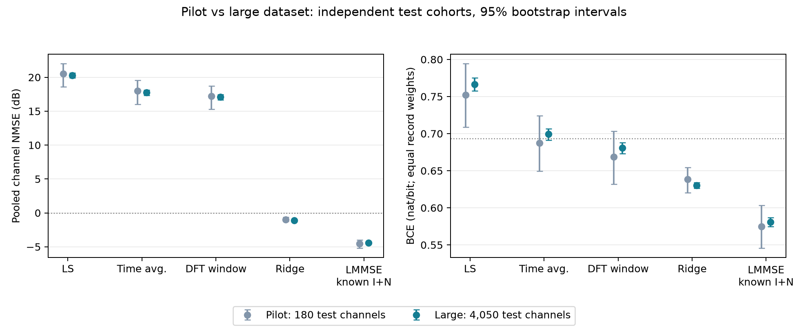
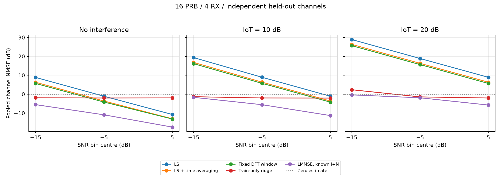
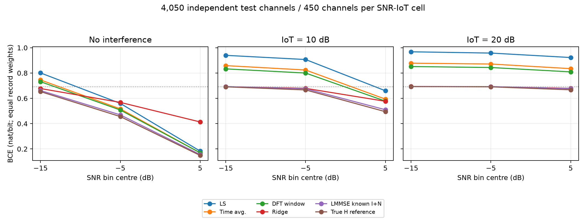

# MSE и BCE линейных оценок канала на 20 250 реализациях

**14 октября 2026, parfen.** На независимых **4050 test-каналах** LS с линейной
интерполяцией даёт **MSE 106.459 / BCE 0.76658**, общая ridge-модель по LS —
**0.76906 / 0.63022**, LMMSE с известной мощностью шума и интерференции —
**0.35841 / 0.58084**. LMMSE — лучший из проверенных методов в среднем по
заданной смеси условий; он использует дополнительную информацию о мощности I+N.

При проверке старых и новых фильтров **на одних и тех же новых test-каналах**
увеличение train/validation снизило MSE ridge на **4.80%**, LMMSE — на **0.217%**.
Большой набор прежде всего уточнил метрики и зависимость от условий.
Измеренный небольшой выигрыш LMMSE относится к данной структуре фильтра,
а не задаёт предел для других линейных методов или нейросетей.

## Данные и протокол

| Параметр | Пробный набор | Новый набор |
| --- | ---: | ---: |
| Всего реализаций | 900 | 20 250 |
| Train | 540 | 12 150 |
| Validation | 180 | 4050 |
| Test | 180 | 4050 |
| Test на семейство канала | 36 | 810 |
| Test на сочетание диапазона SNR и IoT | 20 | 450 |
| Фактический объём данных | 1.26 GB | 28.17 GB, 28.38 GB выделено на диске |
| Время генерации | 5 мин 19 с | 1 ч 58 мин |

Сетка и распределения сохранены: 16 PRB, 192 поднесущие, FFT 256, 14 символов,
один целевой UE, rank 1, 4 RX. CDL-B/C/D, UMa, UMi имеют равные доли;
SNR равномерный от −20 до 10 dB, IoT равновероятно 0/10/20, **IoT=0 означает
отсутствие интерференции**. Число потенциальных интерфереров 2…6, скорости
цели и интерфереров независимо 3…30 км/ч. В test: 1395 QPSK, 1381 16QAM,
1274 64QAM. Все 20 250 seeds уникальны и не пересекаются с пилотным набором.
Диапазоны и распределения проверены в [sampling.csv](reports/sampling.csv)
и [coverage.csv](reports/coverage.csv).

Датасет на parfen:
`/home/debian/WirelessNN/experiments/ce_denoising/data/sustained_16prb_20261014_2h`.
Полный аудит файлов, физических тождеств и битовых меток прошёл; перед
обучением повторно проверены SHA-256 обоих NPZ каждой реализации.

Коэффициенты обучаются только на train. Регуляризация выбирается по MSE на
validation по тем же сеткам, что в [пилотном отчёте](../REPORT.md); test используется
только для оценки. Ни один метод здесь не оптимизируется непосредственно по BCE.

- **LS:** CDM-усреднение DMRS и линейная интерполяция Sionna.
- **LS с усреднением:** две LS-оценки на DMRS усредняются во времени.
- **DFT:** фиксированное окно задержек −1…+3 мкс с последующей интерполяцией.
- **Ridge:** общая affine map из 96 комплексных пилотных LS-коэффициентов в
  2688 RE, одинаковая для RX-портов. Компактные пилоты восстанавливаются из
  полного LS-входа; истинный канал и мощность помех в этот вход не входят.
- **LMMSE:** ковариация чистых пилотов и cross-covariance с истинным H по train,
  диагональная нагрузка `(N0+I0)/4` для текущей записи. Пространственная
  cross-covariance четырёх RX-портов в фильтре не используется.

У ridge выбран множитель `alpha=0.1` при
`lambda=alpha*trace(C_obs)/96`; в пилоте был `alpha=1.0`.
У LMMSE множитель номинальной мощности помех остался **1.0**.
Выборы и все validation-оценки сохранены в служебном `artifacts/analysis.json`.

## Метрики на новом test-наборе

MSE — среднее `|Hhat−H|²` по RE, антеннам и записям. Усреднение отдельно
по real/imag дало бы вдвое меньшее число. NMSE — отношение суммарной ошибки
к суммарной энергии H, затем `10 log10`; средняя энергия H здесь **0.99391**.

BCE считается по кодированным QAM-битам после цепочки Hhat → SIMO combining →
QAM logits. Единицы — **nat/bit**. Сначала усредняются биты одной записи,
затем записи с одинаковыми весами; это не глобальное взвешивание по числу бит.
При вычислении BCE все методы получают одинаковую известную мощность N0+I0.
LMMSE дополнительно использует эту мощность при оценивании самого канала.

| Метод | MSE | 95% интервал MSE | NMSE, dB | BCE | 95% интервал BCE |
| --- | ---: | --- | ---: | ---: | --- |
| Нулевая оценка | 0.99391 | 0.99163…0.99632 | 0.00 | 0.69315 | ≈0.69315 |
| LS | 106.45856 | 97.57375…115.88127 | 20.30 | 0.76658 | 0.75743…0.77524 |
| LS с усреднением | 59.07477 | 54.15527…64.38954 | 17.74 | 0.69920 | 0.69140…0.70672 |
| Фиксированное DFT-окно | 50.76992 | 46.56567…55.18938 | 17.08 | 0.68051 | 0.67318…0.68772 |
| Ridge по LS | 0.76906 | 0.75236…0.78663 | −1.11 | 0.63022 | 0.62617…0.63398 |
| LMMSE с известной I+N | **0.35841** | **0.34805…0.36949** | **−4.43** | **0.58084** | **0.57496…0.58672** |
| LS без шума и интерференции | 0.004771 | 0.004142…0.005443 | −23.19 | 0.57420 | 0.56829…0.58019 |
| Истинный H, reference | 0 | 0 | −∞ | 0.57346 | 0.56752…0.57946 |

95% интервалы — percentile bootstrap, 2000 повторов по **целым реализациям**.
Они отражают вариацию test-каналов при фиксированных фильтрах, не неопределённость
повторного обучения. Антенны и RE одного канала не считаются независимыми
наблюдениями. Для нулевого MSE машинные CSV используют технический floor −300 dB.

LMMSE выигрывает у LS **24.73 dB по MSE**, у нулевой оценки — **4.43 dB**.
Большое первое число связано с высокой ошибкой LS при сильной интерференции.
На test при IoT=20 вклад интерференции в LS MSE равен **282.47**, шума **2.83**,
интерполяции **0.00416**; с перекрёстными членами получается **285.29**.
См. [разложение ошибки](reports/error_components.csv).

## Сравнение с пробным прогоном

В этой таблице фильтры обучены на соответствующих train/validation, а test-наборы
**различны**. Разницу чисел нельзя целиком приписывать размеру обучения.

| Метод | MSE, пилот | MSE, новый | BCE, пилот | BCE, новый |
| --- | ---: | ---: | ---: | ---: |
| LS | 112.65399 | 106.45856 | 0.75212 | 0.76658 |
| LS с усреднением | 63.20233 | 59.07477 | 0.68755 | 0.69920 |
| DFT-окно | 52.60464 | 50.76992 | 0.66847 | 0.68051 |
| Ridge | 0.79669 | 0.76906 | 0.63829 | 0.63022 |
| LMMSE | 0.34865 | 0.35841 | 0.57457 | 0.58084 |
| Истинный H | 0 | 0 | 0.56834 | 0.57346 |

Средний MSE LS снизился, а BCE вырос: эти две метрики не обязаны меняться
одинаково. Изменился даже BCE истинного H, что показывает влияние другой
тестовой выборки. Интервал MSE LMMSE сузился с **0.301…0.399** до
**0.348…0.369**, примерно в 4.6 раза по ширине.

Ошибка noiseless LS выросла с **0.00243** до **0.00477**. Это другая совокупность
каналов и её интерполяционная ошибка: например, для UMa она выросла с 0.00329
до 0.01010. Алгоритм LS между прогонами не менялся.



### Старые и новые фильтры на одинаковых 4050 test-каналах

Пилотные коэффициенты и выбранная на пилотном validation регуляризация
заморожены. Перед переносом проверено совпадение их MSE/BCE с сохранёнными
результатами на трёх исходных pilot test-примерах. Новые фильтры применены к
тем же каналам, шуму, интерференции и символам, что старые.

| Метод | MSE старого фильтра | MSE нового | Снижение MSE | BCE старого | BCE нового |
| --- | ---: | ---: | ---: | ---: | ---: |
| Ridge | 0.80788 | 0.76906 | **4.805%** | 0.642543 | 0.630220 |
| LMMSE | 0.359189 | 0.358410 | **0.217%** | 0.580955 | 0.580841 |

Парные разности «новый минус старый», с 95% интервалами по реализациям:

| Метод | ΔMSE | 95% интервал ΔMSE | ΔBCE | 95% интервал ΔBCE |
| --- | ---: | --- | ---: | --- |
| Ridge | −0.038815 | −0.046182…−0.031270 | −0.012323 | −0.013353…−0.011310 |
| LMMSE | −0.000779 | −0.001007…−0.000559 | −0.000114 | −0.000177…−0.000069 |

Оба интервала LMMSE находятся ниже нуля, но абсолютный эффект мал.
В этом сравнении 540 обучающих реализаций уже дали LMMSE, близкий по качеству
к фильтру на 12 150 реализациях. У ridge выигрыш заметнее; одновременно
изменилась выбранная регуляризация. Это сравнение двух полных процедур
train/validation, а не изолированный эксперимент, меняющий только число train.

Агрегаты: [cohort_comparison.csv](reports/cohort_comparison.csv),
[парное сравнение](reports/same_test_training_size.csv).

## Где методы работают и где теряют качество

Каждая строка ниже объединяет **450 test-каналов**. SNR случаен внутри
диапазона; точки на графике не являются измерениями ровно в центре диапазона.

| IoT | SNR, dB | LS NMSE | DFT NMSE | Ridge NMSE | LMMSE NMSE | LMMSE BCE |
| --- | --- | ---: | ---: | ---: | ---: | ---: |
| 0 | −20…−10 | 8.86 | 5.67 | −1.91 | −5.52 | 0.66168 |
| 0 | −10…0 | −1.09 | −4.16 | −2.02 | −10.90 | 0.46916 |
| 0 | 0…10 | −10.73 | −13.13 | −1.97 | −17.40 | 0.15577 |
| 10 | −20…−10 | 19.33 | 16.12 | −1.33 | −1.67 | 0.69273 |
| 10 | −10…0 | 8.94 | 5.73 | −2.01 | −5.55 | 0.67585 |
| 10 | 0…10 | −1.08 | −4.20 | −2.05 | −11.30 | 0.50989 |
| 20 | −20…−10 | 28.88 | 25.67 | 2.35 | −0.36 | 0.69312 |
| 20 | −10…0 | 18.86 | 15.64 | −1.43 | −1.91 | 0.69269 |
| 20 | 0…10 | 8.91 | 5.67 | −2.03 | −5.75 | 0.67667 |

При **IoT=0 и SNR 0…10** общая ridge-модель излишне подавляет канал:
MSE **0.629**, тогда как у LS **0.0837**, у DFT **0.0482**.
Без интерференции в среднем DFT даёт BCE **0.46977**, лучше ridge **0.55305**.
Поэтому сравнение будущей сети только со средним ridge MSE недостаточно.

При **IoT=20 и SNR −20…−10** ridge хуже нулевой оценки по MSE:
NMSE **+2.35 dB**. LMMSE даёт лишь **−0.36 dB**, а его BCE **0.69312** почти
совпадает с `ln(2)=0.69315`. Даже истинный H в данном приёмнике даёт **0.69284**.





На каждое семейство приходится 810 test-каналов:

| Семейство | Ridge NMSE, dB | LMMSE NMSE, dB | LMMSE BCE |
| --- | ---: | ---: | ---: |
| CDL-B | −1.07 | −4.38 | 0.58788 |
| CDL-C | −0.97 | −4.49 | 0.57732 |
| CDL-D | −1.98 | −5.28 | 0.58992 |
| UMa | −0.66 | −3.77 | 0.58104 |
| UMi | −0.98 | −4.36 | 0.56806 |

На этой выборке CDL-D имеет лучший MSE LMMSE, UMa — худший. Ранжирование BCE
другое; оно отражает всю цепочку канала, combining и demapping.
Разрезы доступны по [семействам](reports/by_channel.csv),
[IoT](reports/by_iot.csv), [SNR и IoT](reports/by_snr_iot.csv)
и [модуляции](reports/by_modulation.csv).

## Значение для обучения модели

Для LS-only модели измеренный общий ориентир — **MSE 0.769 / BCE 0.630**,
но требуется отдельно контролировать хороший SNR без интерференции и плохой
SNR с IoT=20. Если модель получает мощность I+N, более сильный ориентир —
**MSE 0.358 / BCE 0.581**. Разница возможностей входа существенна.

MSE и BCE следует отслеживать одновременно. У текущего LMMSE BCE выше
reference истинного H всего на **0.00738**, но это не оценка расстояния до
предела декодирования. Likelihood использует белую Gaussian модель I+N без
неопределённости Hhat; фактическая интерференция пространственно окрашена.
BCE здесь — surrogate после SIMO combining, а не coded BER/BLER. Истинный H
в этой цепочке также не задаёт универсальный нижний предел BCE для иных
детекторов или способов подавления интерференции.

Модель данных прежняя: Gaussian OFDM-интерфереры, идеальная частотная модель
без ISI/ICI и без загрязнения пилотов соседними PUSCH. Результаты относятся
к этим условиям. Пространственная совместная обработка четырёх RX остаётся
отдельным направлением; она не проверялась данным набором линейных фильтров.

## Воспроизведение и файлы

Расчёт выполнен на parfen в существующем окружении PyTorch 2.14, Sionna 2.1,
NumPy 2.5.3. Основной анализ занял **236.7 с**, пиковая RSS — **5.88 GiB**;
сравнение замороженных фильтров и статистика — ещё около **119 с**.
Линейная алгебра и BCE в этом скрипте выполняются на CPU, четыре потока.
Генерация исходного датасета выполнялась на RTX PRO 6000 Blackwell.

Из корня WirelessNN, при наличии датасетов и сохранённых пилотных фильтров:

```bash
export OMP_NUM_THREADS=4 MKL_NUM_THREADS=4 OPENBLAS_NUM_THREADS=4 MPLBACKEND=Agg
.venv/bin/python -u -m experiments.ce_denoising.analyze \
  --dataset experiments/ce_denoising/data/sustained_16prb_20261014_2h \
  --outdir experiments/ce_denoising/evaluation_20k/reports
.venv/bin/python -u -m experiments.ce_denoising.compare_runs \
  --pilot-dataset experiments/ce_denoising/data/pilot_16prb \
  --dataset experiments/ce_denoising/data/sustained_16prb_20261014_2h \
  --pilot-reports experiments/ce_denoising/reports \
  --outdir experiments/ce_denoising/evaluation_20k/reports
```

Пять тестов анализа и парного сравнения прошли на parfen. Проверяется в том
числе сопоставление реализаций по ID при перемешанном порядке строк и отказ
при различающихся seeds, пропущенных или дублированных примерах.

В этой папке сохранены отчёт, агрегированные CSV и четыре графика.
Каналы остаются на parfen; обученные фильтры и индивидуальные метрики —
в игнорируемом `evaluation_20k/artifacts`, логи — в `runs/evaluation_20k_20261014`.
Исходный пилотный отчёт и его результаты сохранены отдельно.
