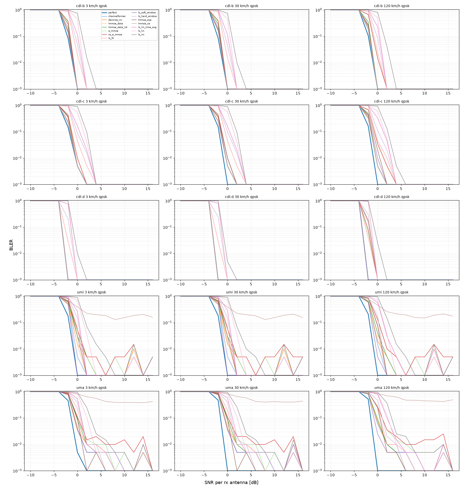
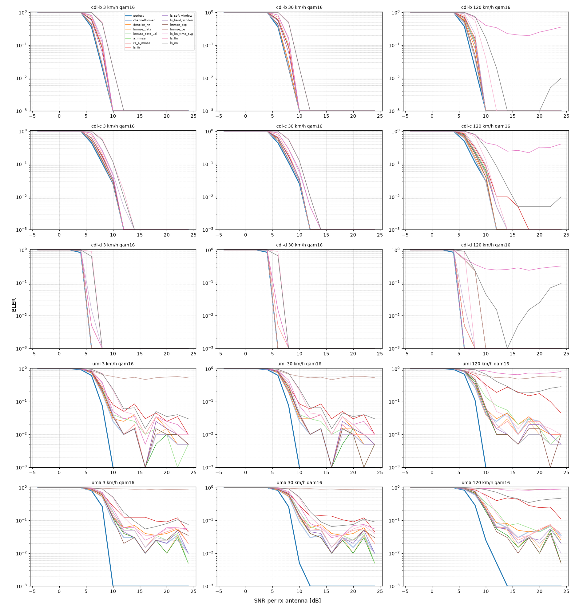
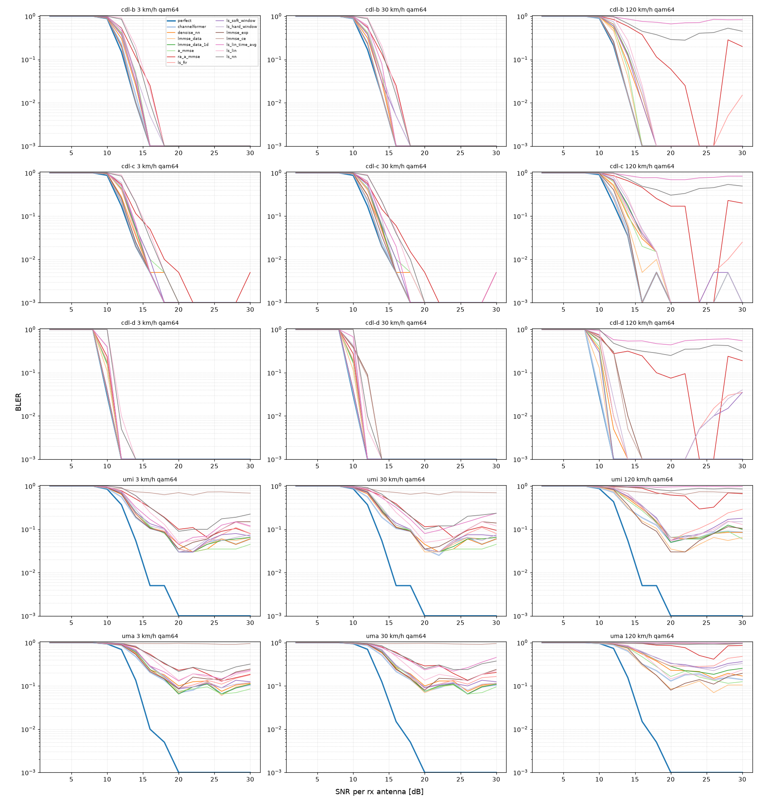
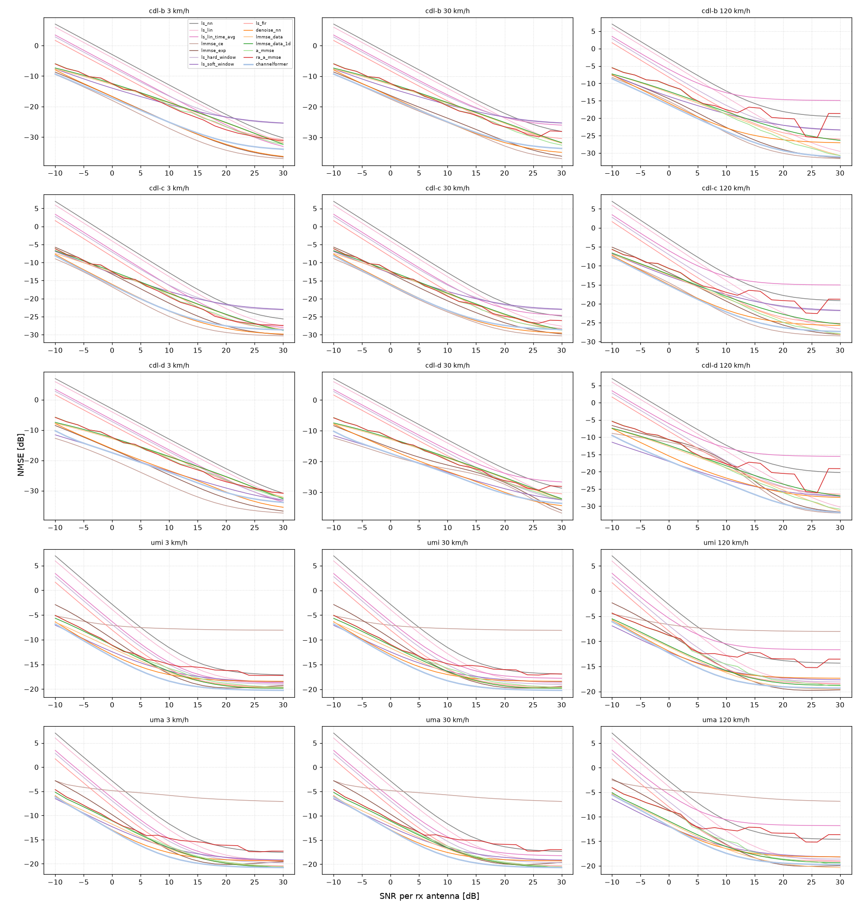

# 4x2 MIMO PUSCH campaign: 14 built-in estimators + Channelformer

## Fixed configuration

| item | value |
|---|---|
| gNB antennas | 4 (38.901 panel 1x2 dual-pol ±45°, 38.901 element pattern) |
| UE antenna ports / layers | 2 (single dual-pol omni) / rank 2, non-codebook |
| UEs / interference | 1 / none (IoT 0 dB) |
| carrier / SCS | 3.5 GHz / 30 kHz |
| PRB / FFT | 68 (816 subcarriers) / 1024 |
| slot | 14 OFDM symbols, mapping type A, normal CP |
| DMRS | type 1, length 1, additional position 1 (symbols 2 and 11), 2 CDM groups w/o data |
| receiver | lmmse (MMSE, S = N0 I) + LDPC decoding |
| power | per_ue (SNR per rx antenna per RE for the whole UE) |
| Monte Carlo | batch 8 slots, stop at 100 block errors on every curve or 200 slots |
| code | upv/WirelessNN 862753e79893fe6d2907966673bc33e8d56ce5c5 (dirty=False), torch 2.14.1+cu130, sionna 2.2.0, NVIDIA RTX PRO 4000 Blackwell SFF Edition |
| Channelformer | checkpoint epoch 25, val NMSE -15.33 dB |

| modulation | MCS table / index | TB size [bit] | peak throughput [Mbit/s] | SNR range [dB] |
|---|---|---|---|---|
| qpsk | 1 / 5 | 14600 | 29.2 | -10 … 16 |
| qam16 | 1 / 14 | 42016 | 84.0 | -4 … 24 |
| qam64 | 1 / 20 | 65576 | 131.2 | 2 … 30 |

Channel delay spreads: CDL-B 100 ns, CDL-C 300 ns, CDL-D 100 ns (defaults); UMi/UMa draw per drop (38.901, low O2I, no pathloss/shadowing). Speeds as listed per scenario.

Estimators marked * (a_mmse, denoise_nn, lmmse_data, lmmse_data_1d, ra_a_mmse) were trained on UMa only (models/paper_ce); everything except UMa is out of their training distribution. Channelformer is trained on a mix of all five channel types. lmmse_ce uses a TDL prior that is the true PDP on CDL only (genie there, mismatched on UMi/UMa).

## SNR [dB] at BLER 10 %, qpsk

| estimator | cdl-b 3 | cdl-b 30 | cdl-b 120 | cdl-c 3 | cdl-c 30 | cdl-c 120 | cdl-d 3 | cdl-d 30 | cdl-d 120 | umi 3 | umi 30 | umi 120 | uma 3 | uma 30 | uma 120 |
|---|---|---|---|---|---|---|---|---|---|---|---|---|---|---|---|
| perfect | -2.1 | -2.1 | -2.0 | -1.8 | -2.0 | -2.0 | -3.8 | -3.8 | -3.8 | -2.0 | -2.0 | -1.9 | -1.3 | -1.9 | -1.9 |
| channelformer | -2.0 | -2.0 | -2.0 | -1.6 | -1.5 | -1.4 | -3.8 | -3.8 | -3.8 | -1.3 | -1.3 | -1.0 | -0.7 | -0.6 | -0.4 |
| denoise_nn* | -2.0 | -2.0 | -1.9 | -1.5 | -1.5 | -1.4 | -3.8 | -3.8 | -3.8 | -1.1 | -1.1 | -0.9 | -0.7 | -0.6 | -0.3 |
| lmmse_data* | -1.9 | -1.9 | -1.9 | -1.3 | -1.3 | -1.3 | -3.8 | -3.8 | -3.8 | -1.0 | -0.9 | -0.7 | -0.5 | -0.4 | -0.1 |
| lmmse_data_1d* | -1.9 | -1.9 | -1.9 | -1.4 | -1.4 | -1.3 | -3.8 | -3.8 | -3.8 | -0.8 | -0.8 | -0.7 | -0.1 | -0.1 | -0.1 |
| a_mmse* | -1.9 | -1.9 | -1.0 | -1.3 | -1.2 | -0.7 | -3.8 | -3.8 | -2.4 | -0.6 | -0.5 | 0.2 | 0.0 | 0.1 | 1.0 |
| ra_a_mmse* | -1.9 | -1.9 | -1.0 | -1.2 | -1.2 | -0.7 | -3.8 | -3.8 | -2.2 | -0.5 | -0.4 | 0.2 | 0.1 | 0.1 | 1.0 |
| ls_fir | -0.9 | -0.9 | -0.8 | -0.5 | -0.5 | -0.5 | -2.7 | -2.7 | -2.6 | -0.4 | -0.3 | -0.1 | 0.5 | 0.5 | 0.6 |
| ls_soft_window | -1.9 | -1.9 | -1.9 | -1.4 | -1.4 | -1.2 | -3.8 | -3.8 | -3.8 | -1.9 | -1.9 | -1.3 | -0.6 | -0.7 | -0.8 |
| ls_hard_window | -0.5 | -0.5 | -0.1 | -0.1 | 0.0 | 0.1 | -1.9 | -1.9 | -1.9 | 0.0 | 0.0 | 0.0 | 0.7 | 0.8 | 1.0 |
| lmmse_exp | -2.0 | -2.0 | -1.9 | -1.4 | -1.3 | -1.0 | -3.8 | -3.8 | -2.0 | -0.7 | -0.7 | -0.2 | -0.0 | -0.1 | 0.5 |
| lmmse_ce | -2.0 | -2.0 | -1.9 | -1.6 | -1.5 | -1.4 | -3.8 | -3.8 | -2.0 | – | – | – | – | – | – |
| ls_lin_time_avg | 0.0 | 0.0 | 0.1 | 0.5 | 0.5 | 1.2 | -1.9 | -1.8 | -1.8 | 0.1 | 0.1 | 1.2 | 0.8 | 1.0 | 2.0 |
| ls_lin | 0.1 | 0.1 | 0.1 | 1.3 | 1.3 | 1.5 | -1.8 | -1.8 | -1.8 | 1.3 | 1.3 | 1.3 | 2.0 | 2.1 | 2.2 |
| ls_nn | 1.0 | 0.9 | 1.4 | 2.0 | 2.0 | 2.2 | -1.0 | -1.1 | -0.8 | 1.7 | 1.7 | 2.3 | 2.8 | 2.8 | 3.0 |

– = 10 % not reached inside the SNR range.

## SNR [dB] at BLER 10 %, qam16

| estimator | cdl-b 3 | cdl-b 30 | cdl-b 120 | cdl-c 3 | cdl-c 30 | cdl-c 120 | cdl-d 3 | cdl-d 30 | cdl-d 120 | umi 3 | umi 30 | umi 120 | uma 3 | uma 30 | uma 120 |
|---|---|---|---|---|---|---|---|---|---|---|---|---|---|---|---|
| perfect | 6.9 | 6.9 | 6.9 | 8.1 | 8.1 | 8.1 | 4.2 | 4.2 | 4.2 | 7.7 | 7.7 | 8.0 | 8.1 | 8.5 | 8.9 |
| channelformer | 7.0 | 7.0 | 7.3 | 8.3 | 8.4 | 8.4 | 4.2 | 4.2 | 4.2 | 8.6 | 8.6 | 9.0 | 9.9 | 9.9 | 11.6 |
| denoise_nn* | 7.0 | 7.1 | 7.8 | 8.3 | 8.4 | 8.7 | 4.2 | 4.2 | 4.2 | 8.7 | 8.7 | 9.4 | 10.7 | 10.7 | 11.7 |
| lmmse_data* | 7.8 | 7.8 | 8.0 | 8.6 | 8.6 | 9.0 | 4.2 | 4.2 | 4.2 | 8.9 | 8.9 | 9.1 | 10.4 | 10.3 | 11.3 |
| lmmse_data_1d* | 7.8 | 7.9 | 8.0 | 8.7 | 8.7 | 9.3 | 4.2 | 4.2 | 4.9 | 8.9 | 9.0 | 9.4 | 10.3 | 10.4 | 11.0 |
| a_mmse* | 7.8 | 7.9 | 8.0 | 8.7 | 8.7 | 9.2 | 4.2 | 4.2 | 4.9 | 9.0 | 9.0 | 11.0 | 11.0 | 11.2 | 13.3 |
| ra_a_mmse* | 7.8 | 7.8 | 8.0 | 8.7 | 8.7 | 9.7 | 4.2 | 4.2 | 4.9 | 9.6 | 9.7 | 22.0 | 17.6 | 18.6 | – |
| ls_fir | 7.9 | 8.0 | 8.0 | 8.8 | 8.8 | 9.5 | 4.9 | 4.9 | 4.9 | 9.0 | 9.0 | 9.5 | 10.7 | 10.7 | 11.3 |
| ls_soft_window | 7.5 | 7.5 | 8.0 | 8.6 | 8.6 | 9.1 | 4.2 | 4.2 | 4.2 | 8.9 | 8.9 | 9.2 | 10.5 | 10.5 | 11.2 |
| ls_hard_window | 8.0 | 8.0 | 8.1 | 9.2 | 9.3 | 9.9 | 5.1 | 5.1 | 5.2 | 9.2 | 9.2 | 9.6 | 10.9 | 11.0 | 11.4 |
| lmmse_exp | 7.0 | 7.0 | 7.4 | 8.4 | 8.4 | 8.9 | 4.2 | 4.2 | 8.1 | 8.9 | 9.0 | 9.6 | 10.2 | 10.5 | 11.0 |
| lmmse_ce | 7.0 | 6.9 | 7.3 | 8.2 | 8.4 | 8.5 | 4.2 | 4.2 | 8.1 | – | – | – | – | – | – |
| ls_lin_time_avg | 8.0 | 8.0 | – | 9.1 | 9.4 | – | 4.9 | 5.1 | – | 9.3 | 9.7 | – | 11.2 | 11.6 | – |
| ls_lin | 9.0 | 9.0 | 9.3 | 10.1 | 10.2 | 10.2 | 6.2 | 6.2 | 6.2 | 11.1 | 11.0 | 11.2 | 12.6 | 12.8 | 13.0 |
| ls_nn | 9.0 | 9.0 | 10.5 | 10.1 | 10.2 | 11.7 | 6.1 | 6.1 | 9.0 | 11.3 | 11.3 | – | 13.8 | 13.7 | – |

– = 10 % not reached inside the SNR range.

## SNR [dB] at BLER 10 %, qam64

| estimator | cdl-b 3 | cdl-b 30 | cdl-b 120 | cdl-c 3 | cdl-c 30 | cdl-c 120 | cdl-d 3 | cdl-d 30 | cdl-d 120 | umi 3 | umi 30 | umi 120 | uma 3 | uma 30 | uma 120 |
|---|---|---|---|---|---|---|---|---|---|---|---|---|---|---|---|
| perfect | 12.3 | 12.4 | 12.6 | 12.5 | 12.5 | 12.8 | 9.3 | 9.3 | 9.3 | 13.4 | 13.4 | 13.4 | 14.2 | 14.2 | 14.4 |
| channelformer | 12.6 | 12.6 | 12.7 | 12.7 | 12.7 | 13.1 | 9.4 | 9.4 | 9.4 | 16.5 | 16.6 | 18.5 | 18.9 | 19.1 | – |
| denoise_nn* | 12.9 | 13.0 | 13.8 | 13.0 | 13.2 | 14.0 | 9.4 | 9.4 | 10.6 | 16.9 | 16.9 | 19.0 | 20.0 | 20.0 | – |
| lmmse_data* | 13.1 | 13.3 | 13.2 | 13.3 | 13.4 | 13.6 | 10.0 | 10.0 | 10.0 | 16.9 | 17.1 | 18.1 | 19.0 | 19.0 | 19.5 |
| lmmse_data_1d* | 13.3 | 13.3 | 14.3 | 13.4 | 13.4 | 14.7 | 10.0 | 10.0 | 10.8 | 16.7 | 17.3 | 18.7 | 18.9 | 19.2 | – |
| a_mmse* | 13.3 | 13.3 | 13.5 | 13.4 | 13.6 | 14.1 | 10.0 | 10.0 | 10.1 | 16.8 | 17.6 | 18.9 | 19.2 | 19.3 | – |
| ra_a_mmse* | 14.2 | 14.4 | 18.4 | 14.3 | 14.8 | 22.0 | 10.1 | 10.1 | 18.0 | 20.0 | 22.6 | – | – | – | – |
| ls_fir | 13.1 | 13.2 | 14.2 | 13.2 | 13.3 | 14.4 | 10.0 | 10.1 | 10.9 | 16.6 | 16.9 | 18.8 | 19.6 | 19.6 | – |
| ls_soft_window | 13.0 | 13.1 | 14.1 | 13.5 | 13.5 | 14.7 | 9.4 | 9.4 | 10.1 | 18.1 | 18.0 | 19.0 | 19.5 | 19.7 | – |
| ls_hard_window | 13.3 | 13.4 | 14.5 | 13.6 | 13.8 | 15.1 | 10.1 | 10.1 | 11.2 | 18.0 | 18.0 | 19.1 | 19.7 | 19.8 | – |
| lmmse_exp | 12.5 | 12.6 | 12.7 | 12.8 | 13.0 | 13.4 | 9.4 | 11.9 | 12.7 | 16.5 | 16.9 | 17.5 | 19.4 | 19.3 | 19.4 |
| lmmse_ce | 12.4 | 12.6 | 12.6 | 12.6 | 12.7 | 12.9 | 9.4 | 11.7 | 12.5 | – | – | – | – | – | – |
| ls_lin_time_avg | 13.3 | 13.8 | – | 13.6 | 13.9 | – | 10.1 | 10.1 | – | 18.1 | 19.4 | – | – | – | – |
| ls_lin | 14.6 | 14.6 | 14.8 | 14.9 | 15.0 | 15.1 | 11.0 | 10.9 | 11.0 | 18.5 | 18.5 | 18.7 | – | – | – |
| ls_nn | 14.3 | 14.4 | – | 14.7 | 14.9 | – | 10.9 | 11.0 | – | 19.7 | 20.0 | – | – | – | – |

– = 10 % not reached inside the SNR range.

## Loss vs perfect CSI at BLER 10 % [dB], qpsk

| estimator | cdl-b 3 | cdl-b 30 | cdl-b 120 | cdl-c 3 | cdl-c 30 | cdl-c 120 | cdl-d 3 | cdl-d 30 | cdl-d 120 | umi 3 | umi 30 | umi 120 | uma 3 | uma 30 | uma 120 |
|---|---|---|---|---|---|---|---|---|---|---|---|---|---|---|---|
| channelformer | 0.16 | 0.18 | 0.04 | 0.18 | 0.44 | 0.52 | 0.00 | 0.00 | 0.00 | 0.65 | 0.65 | 0.92 | 0.64 | 1.27 | 1.49 |
| denoise_nn* | 0.17 | 0.17 | 0.05 | 0.22 | 0.45 | 0.54 | 0.00 | 0.00 | 0.00 | 0.87 | 0.88 | 1.00 | 0.65 | 1.26 | 1.59 |
| lmmse_data* | 0.21 | 0.21 | 0.09 | 0.48 | 0.67 | 0.63 | 0.00 | 0.00 | 0.00 | 0.93 | 1.01 | 1.29 | 0.83 | 1.44 | 1.74 |
| lmmse_data_1d* | 0.21 | 0.21 | 0.09 | 0.38 | 0.58 | 0.62 | 0.00 | 0.00 | 0.00 | 1.16 | 1.16 | 1.29 | 1.18 | 1.74 | 1.78 |
| a_mmse* | 0.23 | 0.23 | 0.99 | 0.41 | 0.74 | 1.25 | 0.00 | 0.00 | 1.47 | 1.35 | 1.47 | 2.15 | 1.33 | 1.93 | 2.83 |
| ra_a_mmse* | 0.23 | 0.23 | 1.00 | 0.54 | 0.75 | 1.26 | 0.00 | 0.00 | 1.66 | 1.47 | 1.53 | 2.17 | 1.42 | 2.00 | 2.85 |
| ls_fir | 1.27 | 1.19 | 1.22 | 1.23 | 1.44 | 1.44 | 1.15 | 1.15 | 1.26 | 1.57 | 1.62 | 1.80 | 1.85 | 2.35 | 2.46 |
| ls_soft_window | 0.19 | 0.19 | 0.07 | 0.37 | 0.57 | 0.72 | 0.00 | 0.00 | 0.00 | 0.08 | 0.08 | 0.69 | 0.71 | 1.21 | 1.08 |
| ls_hard_window | 1.66 | 1.61 | 1.86 | 1.67 | 1.97 | 2.07 | 1.89 | 1.90 | 1.92 | 1.99 | 1.98 | 1.99 | 2.07 | 2.64 | 2.86 |
| lmmse_exp | 0.17 | 0.18 | 0.07 | 0.36 | 0.69 | 0.96 | 0.00 | 0.00 | 1.88 | 1.22 | 1.22 | 1.71 | 1.28 | 1.79 | 2.34 |
| lmmse_ce | 0.16 | 0.17 | 0.06 | 0.20 | 0.43 | 0.57 | 0.00 | 0.00 | 1.87 | – | – | – | – | – | – |
| ls_lin_time_avg | 2.14 | 2.14 | 2.06 | 2.24 | 2.42 | 3.16 | 1.98 | 1.99 | 2.00 | 2.03 | 2.03 | 3.13 | 2.17 | 2.93 | 3.88 |
| ls_lin | 2.24 | 2.24 | 2.11 | 3.06 | 3.28 | 3.46 | 2.00 | 2.00 | 2.00 | 3.25 | 3.25 | 3.25 | 3.36 | 3.95 | 4.05 |
| ls_nn | 3.16 | 3.06 | 3.39 | 3.72 | 3.92 | 4.12 | 2.83 | 2.70 | 3.08 | 3.67 | 3.67 | 4.27 | 4.11 | 4.70 | 4.85 |

## Loss vs perfect CSI at BLER 10 % [dB], qam16

| estimator | cdl-b 3 | cdl-b 30 | cdl-b 120 | cdl-c 3 | cdl-c 30 | cdl-c 120 | cdl-d 3 | cdl-d 30 | cdl-d 120 | umi 3 | umi 30 | umi 120 | uma 3 | uma 30 | uma 120 |
|---|---|---|---|---|---|---|---|---|---|---|---|---|---|---|---|
| channelformer | 0.15 | 0.13 | 0.36 | 0.20 | 0.23 | 0.29 | 0.01 | 0.01 | 0.01 | 0.87 | 0.90 | 1.02 | 1.81 | 1.40 | 2.77 |
| denoise_nn* | 0.15 | 0.21 | 0.87 | 0.24 | 0.23 | 0.56 | 0.01 | 0.01 | 0.01 | 0.98 | 0.98 | 1.40 | 2.60 | 2.26 | 2.84 |
| lmmse_data* | 0.90 | 0.95 | 1.11 | 0.55 | 0.52 | 0.85 | 0.01 | 0.01 | 0.01 | 1.14 | 1.17 | 1.10 | 2.32 | 1.78 | 2.41 |
| lmmse_data_1d* | 0.96 | 1.00 | 1.12 | 0.63 | 0.57 | 1.18 | 0.01 | 0.01 | 0.71 | 1.19 | 1.23 | 1.38 | 2.26 | 1.96 | 2.15 |
| a_mmse* | 0.95 | 1.00 | 1.12 | 0.63 | 0.57 | 1.04 | 0.01 | 0.01 | 0.71 | 1.27 | 1.32 | 3.01 | 2.97 | 2.67 | 4.42 |
| ra_a_mmse* | 0.90 | 0.95 | 1.13 | 0.63 | 0.59 | 1.60 | 0.01 | 0.01 | 0.71 | 1.89 | 2.02 | 13.99 | 9.55 | 10.15 | – |
| ls_fir | 1.07 | 1.12 | 1.13 | 0.73 | 0.68 | 1.40 | 0.71 | 0.71 | 0.71 | 1.29 | 1.31 | 1.48 | 2.66 | 2.21 | 2.38 |
| ls_soft_window | 0.66 | 0.65 | 1.10 | 0.55 | 0.52 | 0.99 | 0.01 | 0.01 | 0.01 | 1.17 | 1.18 | 1.20 | 2.42 | 2.01 | 2.32 |
| ls_hard_window | 1.15 | 1.15 | 1.16 | 1.10 | 1.14 | 1.77 | 0.94 | 0.94 | 1.02 | 1.44 | 1.52 | 1.58 | 2.87 | 2.48 | 2.56 |
| lmmse_exp | 0.14 | 0.08 | 0.52 | 0.33 | 0.27 | 0.71 | 0.01 | 0.01 | 3.91 | 1.14 | 1.31 | 1.55 | 2.09 | 2.05 | 2.11 |
| lmmse_ce | 0.13 | 0.06 | 0.37 | 0.16 | 0.23 | 0.32 | 0.01 | 0.01 | 3.91 | – | – | – | – | – | – |
| ls_lin_time_avg | 1.13 | 1.15 | – | 0.99 | 1.30 | – | 0.71 | 0.94 | – | 1.59 | 1.95 | – | 3.15 | 3.16 | – |
| ls_lin | 2.12 | 2.12 | 2.41 | 2.07 | 2.05 | 2.06 | 2.01 | 2.00 | 2.00 | 3.34 | 3.26 | 3.19 | 4.53 | 4.27 | 4.17 |
| ls_nn | 2.09 | 2.10 | 3.57 | 2.05 | 2.05 | 3.60 | 1.98 | 1.98 | 4.88 | 3.53 | 3.61 | – | 5.76 | 5.22 | – |

## Loss vs perfect CSI at BLER 10 % [dB], qam64

| estimator | cdl-b 3 | cdl-b 30 | cdl-b 120 | cdl-c 3 | cdl-c 30 | cdl-c 120 | cdl-d 3 | cdl-d 30 | cdl-d 120 | umi 3 | umi 30 | umi 120 | uma 3 | uma 30 | uma 120 |
|---|---|---|---|---|---|---|---|---|---|---|---|---|---|---|---|
| channelformer | 0.31 | 0.19 | 0.11 | 0.23 | 0.24 | 0.38 | 0.06 | 0.06 | 0.06 | 3.09 | 3.26 | 5.07 | 4.68 | 4.87 | – |
| denoise_nn* | 0.59 | 0.54 | 1.20 | 0.49 | 0.73 | 1.24 | 0.12 | 0.12 | 1.27 | 3.58 | 3.58 | 5.59 | 5.77 | 5.79 | – |
| lmmse_data* | 0.76 | 0.81 | 0.69 | 0.84 | 0.90 | 0.81 | 0.69 | 0.70 | 0.71 | 3.58 | 3.77 | 4.67 | 4.79 | 4.81 | 5.17 |
| lmmse_data_1d* | 0.98 | 0.85 | 1.71 | 0.86 | 0.93 | 1.96 | 0.73 | 0.73 | 1.53 | 3.37 | 3.93 | 5.28 | 4.70 | 4.96 | – |
| a_mmse* | 1.03 | 0.85 | 0.99 | 0.93 | 1.06 | 1.35 | 0.72 | 0.73 | 0.79 | 3.40 | 4.25 | 5.46 | 4.98 | 5.09 | – |
| ra_a_mmse* | 1.88 | 1.92 | 5.87 | 1.84 | 2.35 | 9.28 | 0.75 | 0.76 | 8.69 | 6.63 | 9.22 | – | – | – | – |
| ls_fir | 0.76 | 0.76 | 1.65 | 0.72 | 0.79 | 1.69 | 0.73 | 0.74 | 1.55 | 3.26 | 3.58 | 5.42 | 5.36 | 5.42 | – |
| ls_soft_window | 0.74 | 0.61 | 1.58 | 0.96 | 1.03 | 1.92 | 0.12 | 0.12 | 0.77 | 4.71 | 4.63 | 5.59 | 5.28 | 5.49 | – |
| ls_hard_window | 1.05 | 0.92 | 1.95 | 1.11 | 1.34 | 2.33 | 0.79 | 0.80 | 1.88 | 4.63 | 4.63 | 5.71 | 5.44 | 5.61 | – |
| lmmse_exp | 0.18 | 0.18 | 0.11 | 0.31 | 0.53 | 0.64 | 0.06 | 2.55 | 3.34 | 3.09 | 3.58 | 4.10 | 5.16 | 5.08 | 5.05 |
| lmmse_ce | 0.14 | 0.16 | 0.04 | 0.12 | 0.22 | 0.18 | 0.06 | 2.40 | 3.22 | – | – | – | – | – | – |
| ls_lin_time_avg | 0.95 | 1.34 | – | 1.08 | 1.45 | – | 0.79 | 0.83 | – | 4.74 | 6.04 | – | – | – | – |
| ls_lin | 2.32 | 2.18 | 2.28 | 2.40 | 2.48 | 2.35 | 1.69 | 1.56 | 1.69 | 5.18 | 5.11 | 5.25 | – | – | – |
| ls_nn | 2.02 | 1.98 | – | 2.25 | 2.43 | – | 1.56 | 1.69 | – | 6.33 | 6.63 | – | – | – | – |

## CE NMSE [dB] (common random numbers over SNR, 64 slots per point)

### SNR 0 dB

| estimator | cdl-b 3 | cdl-b 30 | cdl-b 120 | cdl-c 3 | cdl-c 30 | cdl-c 120 | cdl-d 3 | cdl-d 30 | cdl-d 120 | umi 3 | umi 30 | umi 120 | uma 3 | uma 30 | uma 120 |
|---|---|---|---|---|---|---|---|---|---|---|---|---|---|---|---|
| channelformer | -17.2 | -17.1 | -16.2 | -16.3 | -16.2 | -15.2 | -17.5 | -17.4 | -16.9 | -13.5 | -13.4 | -12.4 | -13.1 | -13.0 | -11.9 |
| denoise_nn* | -16.7 | -16.6 | -15.7 | -16.1 | -16.0 | -15.0 | -16.2 | -16.1 | -15.5 | -13.0 | -13.0 | -12.0 | -13.0 | -12.9 | -11.8 |
| lmmse_data* | -12.8 | -12.8 | -12.6 | -12.8 | -12.8 | -12.5 | -12.9 | -12.9 | -12.8 | -11.7 | -11.7 | -11.1 | -11.8 | -11.8 | -11.2 |
| lmmse_data_1d* | -12.5 | -12.5 | -12.3 | -12.4 | -12.4 | -12.3 | -12.5 | -12.5 | -12.4 | -11.1 | -11.1 | -10.9 | -11.1 | -11.1 | -10.9 |
| a_mmse* | -12.6 | -12.5 | -10.7 | -12.6 | -12.5 | -10.8 | -12.5 | -12.4 | -10.8 | -11.2 | -11.0 | -8.9 | -11.1 | -10.9 | -8.8 |
| ra_a_mmse* | -12.5 | -12.4 | -10.6 | -12.5 | -12.4 | -10.7 | -12.4 | -12.3 | -10.7 | -11.1 | -10.9 | -8.8 | -11.0 | -10.8 | -8.8 |
| ls_fir | -8.3 | -8.3 | -8.3 | -8.3 | -8.3 | -8.3 | -8.4 | -8.4 | -8.3 | -8.1 | -8.1 | -8.0 | -8.1 | -8.1 | -8.0 |
| ls_soft_window | -14.0 | -14.0 | -13.8 | -13.0 | -12.9 | -12.8 | -17.4 | -17.4 | -17.1 | -12.5 | -12.4 | -12.2 | -12.3 | -12.3 | -12.0 |
| ls_hard_window | -7.1 | -7.1 | -7.1 | -7.1 | -7.1 | -7.1 | -7.2 | -7.2 | -7.2 | -7.0 | -7.0 | -6.9 | -7.0 | -7.0 | -6.9 |
| lmmse_exp | -16.7 | -16.3 | -14.4 | -13.2 | -13.1 | -11.8 | -16.3 | -15.5 | -10.7 | -9.8 | -9.7 | -8.6 | -9.9 | -9.7 | -8.6 |
| lmmse_ce | -18.0 | -17.5 | -15.2 | -16.8 | -16.4 | -14.5 | -19.8 | -18.1 | -11.5 | -7.1 | -7.0 | -6.7 | -4.9 | -4.8 | -4.6 |
| ls_lin_time_avg | -6.5 | -6.5 | -6.0 | -6.6 | -6.6 | -6.0 | -6.6 | -6.6 | -6.1 | -6.4 | -6.3 | -5.4 | -6.4 | -6.3 | -5.5 |
| ls_lin | -4.0 | -4.0 | -4.0 | -4.0 | -4.0 | -4.0 | -4.1 | -4.1 | -4.1 | -3.9 | -3.9 | -3.9 | -3.9 | -3.9 | -3.9 |
| ls_nn | -3.0 | -3.0 | -2.9 | -3.0 | -3.0 | -2.9 | -3.0 | -3.0 | -3.0 | -2.9 | -2.8 | -2.7 | -2.9 | -2.9 | -2.7 |

### SNR 10 dB

| estimator | cdl-b 3 | cdl-b 30 | cdl-b 120 | cdl-c 3 | cdl-c 30 | cdl-c 120 | cdl-d 3 | cdl-d 30 | cdl-d 120 | umi 3 | umi 30 | umi 120 | uma 3 | uma 30 | uma 120 |
|---|---|---|---|---|---|---|---|---|---|---|---|---|---|---|---|
| channelformer | -25.1 | -24.9 | -23.8 | -23.4 | -23.2 | -22.1 | -24.0 | -23.9 | -23.4 | -18.4 | -18.3 | -17.4 | -18.6 | -18.4 | -17.4 |
| denoise_nn* | -25.2 | -25.0 | -22.8 | -23.5 | -23.3 | -21.6 | -23.4 | -23.3 | -21.8 | -17.1 | -17.0 | -16.0 | -17.7 | -17.6 | -16.5 |
| lmmse_data* | -18.8 | -18.8 | -18.7 | -18.6 | -18.6 | -18.6 | -18.9 | -18.9 | -18.8 | -16.6 | -16.6 | -16.3 | -16.9 | -16.9 | -16.5 |
| lmmse_data_1d* | -18.6 | -18.6 | -18.1 | -18.5 | -18.5 | -18.0 | -18.7 | -18.7 | -18.3 | -16.4 | -16.4 | -15.8 | -16.7 | -16.7 | -16.1 |
| a_mmse* | -19.5 | -19.5 | -18.9 | -19.2 | -19.2 | -18.4 | -19.5 | -19.4 | -19.0 | -15.8 | -15.7 | -14.5 | -16.4 | -16.3 | -14.9 |
| ra_a_mmse* | -19.9 | -19.7 | -17.5 | -19.5 | -19.3 | -17.0 | -19.8 | -19.6 | -17.8 | -15.0 | -14.8 | -12.9 | -14.7 | -14.5 | -12.6 |
| ls_fir | -18.1 | -18.1 | -17.7 | -18.0 | -18.0 | -17.6 | -18.2 | -18.2 | -17.8 | -16.0 | -15.9 | -15.4 | -16.3 | -16.3 | -15.7 |
| ls_soft_window | -19.3 | -19.3 | -18.7 | -18.0 | -18.0 | -17.6 | -23.6 | -23.5 | -22.3 | -16.4 | -16.3 | -15.8 | -16.7 | -16.6 | -16.1 |
| ls_hard_window | -16.6 | -16.6 | -16.3 | -16.3 | -16.3 | -16.0 | -17.2 | -17.2 | -16.9 | -15.1 | -15.0 | -14.7 | -15.3 | -15.3 | -14.9 |
| lmmse_exp | -25.1 | -23.7 | -22.6 | -21.3 | -20.6 | -19.3 | -24.8 | -21.2 | -17.1 | -17.0 | -16.4 | -15.5 | -17.2 | -16.6 | -15.6 |
| lmmse_ce | -27.2 | -25.1 | -24.1 | -25.0 | -23.7 | -22.7 | -28.2 | -22.4 | -17.6 | -7.8 | -7.7 | -7.7 | -5.8 | -5.7 | -5.6 |
| ls_lin_time_avg | -16.5 | -16.1 | -12.7 | -16.4 | -16.0 | -12.8 | -16.6 | -16.3 | -13.1 | -14.6 | -14.2 | -10.5 | -14.8 | -14.4 | -10.6 |
| ls_lin | -14.0 | -14.0 | -13.9 | -13.9 | -13.9 | -13.9 | -14.0 | -14.0 | -14.0 | -12.8 | -12.8 | -12.7 | -13.0 | -13.0 | -12.9 |
| ls_nn | -12.9 | -12.9 | -12.2 | -12.8 | -12.8 | -12.1 | -13.0 | -13.0 | -12.3 | -11.6 | -11.6 | -10.6 | -11.8 | -11.7 | -10.7 |

### SNR 20 dB

| estimator | cdl-b 3 | cdl-b 30 | cdl-b 120 | cdl-c 3 | cdl-c 30 | cdl-c 120 | cdl-d 3 | cdl-d 30 | cdl-d 120 | umi 3 | umi 30 | umi 120 | uma 3 | uma 30 | uma 120 |
|---|---|---|---|---|---|---|---|---|---|---|---|---|---|---|---|
| channelformer | -31.5 | -31.2 | -29.3 | -27.6 | -27.4 | -26.3 | -30.6 | -30.5 | -29.3 | -20.0 | -19.9 | -19.1 | -20.5 | -20.4 | -19.5 |
| denoise_nn* | -32.4 | -31.7 | -26.2 | -28.2 | -28.0 | -24.9 | -30.4 | -30.1 | -26.0 | -18.3 | -18.2 | -17.2 | -19.2 | -19.1 | -18.0 |
| lmmse_data* | -25.4 | -25.4 | -25.1 | -24.4 | -24.5 | -24.2 | -25.5 | -25.5 | -25.3 | -19.3 | -19.3 | -19.0 | -19.8 | -19.8 | -19.6 |
| lmmse_data_1d* | -25.3 | -25.1 | -23.3 | -24.4 | -24.3 | -22.8 | -25.4 | -25.3 | -23.6 | -19.4 | -19.3 | -18.3 | -19.9 | -19.8 | -18.8 |
| a_mmse* | -26.6 | -26.6 | -26.1 | -25.3 | -25.4 | -24.9 | -26.5 | -26.5 | -26.1 | -18.8 | -18.8 | -17.9 | -19.6 | -19.6 | -18.6 |
| ra_a_mmse* | -27.6 | -26.5 | -20.0 | -25.8 | -24.9 | -19.2 | -27.1 | -26.2 | -20.5 | -16.2 | -16.0 | -13.5 | -16.2 | -15.9 | -13.4 |
| ls_fir | -26.7 | -26.5 | -24.2 | -25.7 | -25.5 | -23.6 | -26.7 | -26.6 | -24.5 | -19.1 | -19.0 | -18.1 | -19.9 | -19.8 | -18.6 |
| ls_soft_window | -23.4 | -23.4 | -22.0 | -21.6 | -21.5 | -20.6 | -29.1 | -28.9 | -25.7 | -18.1 | -18.0 | -17.3 | -18.7 | -18.6 | -17.8 |
| ls_hard_window | -23.4 | -23.3 | -22.0 | -21.8 | -21.8 | -20.9 | -26.6 | -26.5 | -24.4 | -18.5 | -18.4 | -17.6 | -19.1 | -19.1 | -18.1 |
| lmmse_exp | -32.6 | -31.1 | -29.0 | -27.6 | -26.7 | -25.6 | -32.5 | -26.8 | -27.9 | -19.8 | -19.6 | -19.5 | -20.2 | -20.0 | -19.8 |
| lmmse_ce | -34.3 | -32.8 | -30.1 | -29.4 | -28.8 | -27.5 | -35.0 | -27.4 | -29.1 | -8.0 | -8.0 | -8.0 | -6.7 | -6.6 | -6.5 |
| ls_lin_time_avg | -26.1 | -23.5 | -14.6 | -24.5 | -22.7 | -14.8 | -26.2 | -23.9 | -15.3 | -18.2 | -17.3 | -11.6 | -18.7 | -17.7 | -11.7 |
| ls_lin | -23.7 | -23.7 | -23.3 | -22.8 | -22.8 | -22.4 | -23.9 | -23.9 | -23.5 | -17.7 | -17.7 | -17.5 | -18.2 | -18.2 | -17.9 |
| ls_nn | -22.6 | -22.1 | -18.1 | -21.4 | -21.1 | -17.8 | -22.8 | -22.3 | -18.6 | -16.2 | -16.0 | -13.8 | -16.6 | -16.4 | -14.1 |

